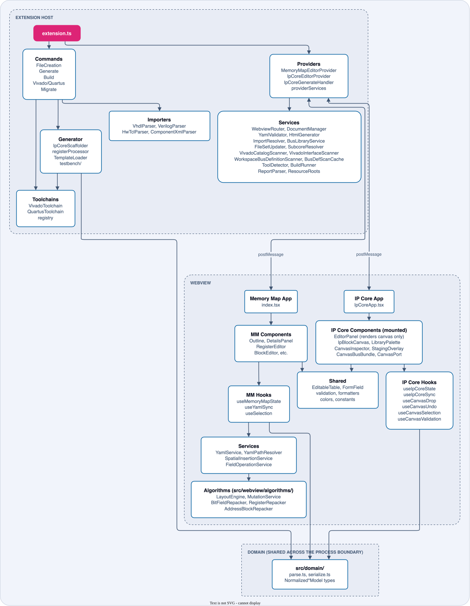
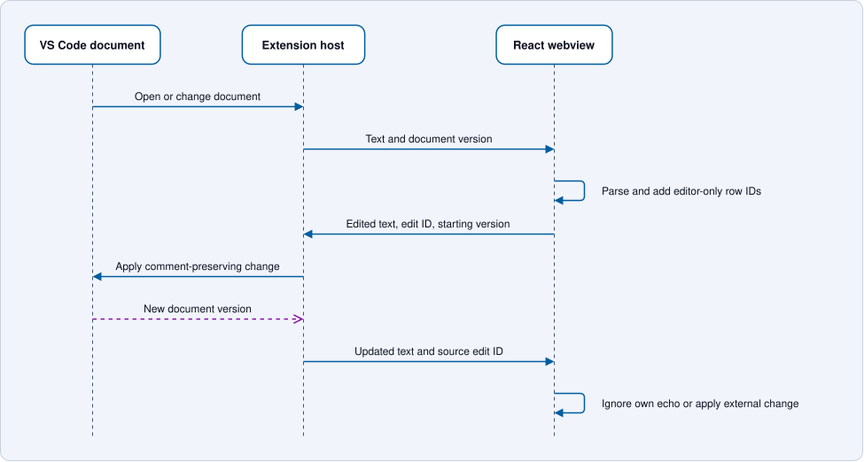

# Architecture Overview

## System overview

`ipcraft-vscode` is a VS Code extension with four webview surfaces:

| Surface | Files | Kind |
|---|---|---|
| IP Core editor | `*.ip.yml` | Visual editor |
| Memory Map editor | `*.mm.yml` | Visual editor |
| Data Inspector | `*.ipci.yml`, or a panel opened from a register or port | Analysis tool |
| System diagram | Vivado block design `.tcl`, Platform Designer `.qsys` and system `.tcl` | Read-only viewer |

The **extension host** is the Node.js process that can access VS Code and the
file system. A **webview** is an embedded browser that renders one of these
surfaces. They share domain types but communicate only through messages.

## High-Level Structure

## Data Flow

The extension host owns the VS Code document. The webview owns the visible
editor state. Versioned messages keep them in step without losing external
edits or re-applying the webview's own changes.

### Document open

1. VS Code calls `resolveCustomTextEditor` for a matching file.
2. The provider creates the webview HTML and waits for a `ready` message.
3. The provider sends `update` with the text and its `docVersion`. For IP core
   files it also sends the resolved imports.
4. The webview parses the YAML with `src/domain/parse.ts` into the normalized
   model and adds editor-only values such as `rowId`.

### User edit

1. A component requests a path edit such as `['fields', 0, 'name']`, or a
   structured operation such as `['__op', 'field-move']` so that no invalid
   intermediate state reaches the file.
2. `src/yamledit/` applies it to the parsed YAML document, keeping comments and
   number spellings such as hexadecimal values.
3. Serialization removes `rowId`, `__kind`, and other editor-only values.
4. The webview posts `update` with the full text, a monotonic `editId`, and the
   `baseDocVersion` it started from.
5. `WebviewRouter` passes it to `DocumentManager`, which applies writes in order.

### Stale edits and echoes

If the document changed after `baseDocVersion`, the host rejects the edit and
replies with `forceResync: true`. The webview drops:

- an echo that carries its own completed edit ID;
- an update older than the newest version it already shows.

`src/services/WebviewRouter.ts` and `src/webview/sync/revisionFilter.ts`
implement the two sides of this rule. Change and test them together.

### Host commands

The webview can post `command` (`save`, `validate`, `openFile`). The host runs
the VS Code action and may show a notification.

### Canvas edit (IP Core only)

1. User drags an item from the library palette and drops it on the `IpBlockCanvas`
2. `useCanvasDrop` resolves the payload into an IP Core update (e.g., push to `clocks`, `ports`, or `busInterfaces`)
3. `useCanvasUndo` snapshots the prior YAML before applying the update
4. `updateIpCore` writes the new value into the parsed model
5. `useIpCoreSync` serialises the model back to YAML and posts `type: 'update'` to the host (same path as a form edit)

Canvas keyboard shortcuts (Delete, Ctrl+D, Ctrl+Z/Y) follow the same update path through `updateIpCore`.

### HDL generation

1. The user picks the HDL language, vendor targets, and scaffold pack in the
   IP Core toolbar and runs Scaffold Project or a generate command.
2. The webview posts `generate`; `IpCoreGenerateHandler` runs
   `IpCoreScaffolder`, which renders every file in memory.
3. The files are shown in the staging review (`StagingPanel`,
   `WebviewStagingBridge`). Nothing is written until the user confirms.
4. The host posts `generateResult` with the written files or the error.

See [Generator architecture](generator-backbone.md).

## System viewer

A third, read-only surface shows Vivado `write_bd_tcl` scripts, Platform Designer
`.qsys` systems, and Platform Designer system scripts as a diagram. It is not
part of the YAML round trip: the files are read statically and never written.

| Part | Location |
|---|---|
| Readers that turn a file into a vendor-neutral `SystemGraph` | `src/parser/system/` |
| Detection and `readSystemDesign` entry point | `src/services/systemDiagram/` |
| Custom editor provider (`ipcraft.systemDiagram`, `priority: option`) | `src/providers/SystemDiagramProvider.ts` |
| Workspace enrichment from `.ip.yml` and HDL files | `src/services/systemDiagram/SystemDesignEnricher.ts` |
| Webview (React Flow and elkjs layout) | `src/webview/systemDiagram/` |

## Build and Packaging

| Output | Location |
|--------|----------|
| Extension bundle | `dist/extension.js` |
| Command-line bundle | `dist/cli.js` |
| Memory Map webview bundle | `dist/webview.js` |
| IP Core webview bundle | `dist/ipcore.js` |
| Data Inspector bundle | `dist/dataInspector.js` |
| System diagram bundle | `dist/systemDiagram.js` |
| Shared elkjs layout engine (system diagram page and CLI) | `dist/elk.bundled.js` |
| IBM Plex fonts for rendered images | `dist/resources/fonts/` |
| Nunjucks templates and scaffold packs | `dist/templates/`, `dist/packs/` |
| Compiled tests | `out/**` |

Built with webpack. See [Development Setup](../getting-started/development.md) for commands.

## Webview Security

`HtmlGenerator` applies a Content Security Policy with `default-src 'none'`. Scripts, styles,
fonts, and other resources are restricted to the extension's own `webview.cspSource`. Webviews
cannot access the file system directly; all privileged operations cross the typed message bridge,
and host commands are checked against an allow-list.

## YAML Libraries

| Library | When to use |
|---|---|
| `js-yaml` (v4) | Read-only parsing or simple output where formatting does not matter |
| `yaml` (v2) through `src/yamledit/` | Any edit written back to an existing document; keeps comments and hexadecimal spelling |
