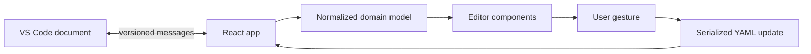
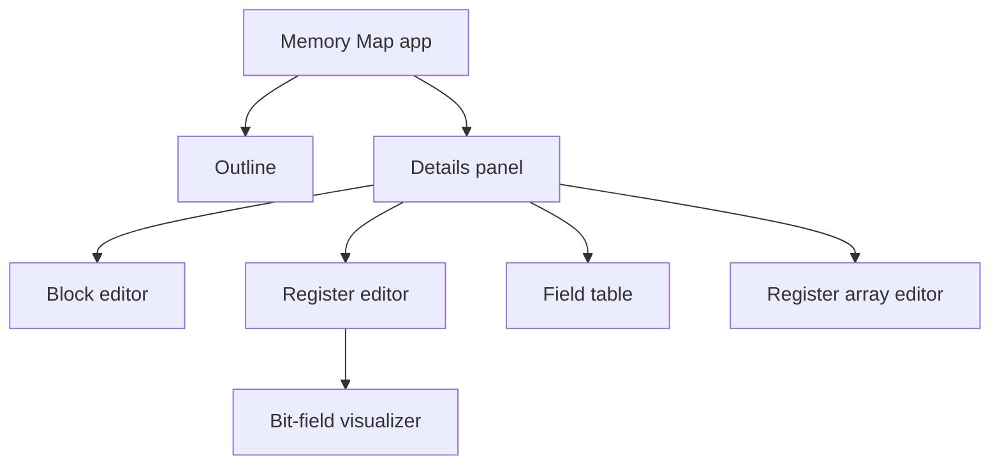

# Webview Architecture

IPCraft has two React applications running in VS Code webviews. A webview is an
embedded browser: it can render the editor interface, but it cannot read project
files or start external tools directly.

| Editor     | Entry point                        | Root element   |
| ---------- | ---------------------------------- | -------------- |
| Memory Map | `src/webview/index.tsx`            | `#root`        |
| IP Core    | `src/webview/ipcore/IpCoreApp.tsx` | `#ipcore-root` |

A third, read-only bundle, `src/webview/systemDiagram/index.tsx`, renders system
designs (`#system-diagram-root`). It is described in
[System diagram application](#system-diagram-application).

## Shared boundary



Both applications use `src/domain/parse.ts` to convert document data into the
editor model and `src/domain/serialize.ts` to remove editor-only values before
writing YAML.

`rowId` identifies a React row across renders. It is never document data.

## Memory Map application

The Memory Map app has three main regions:

- `Outline` selects blocks, registers, arrays, and fields;
- `DetailsPanel` chooses the editor for the selected item;
- visualizers show bit and address layouts.

The table editors for blocks, registers, and fields share
`useTableEditorState`. It combines keyboard navigation, draft protection, and
the pointer insert bar.



Layout calculations belong in pure functions under
`src/webview/algorithms/`. Components request an operation and render the
result; they should not contain separate address or bit-position formulas.

## IP Core application

The IP Core app uses a block-diagram canvas:

- `LibraryPalette` supplies items to add;
- `IpBlockCanvas` draws ports, parameters, clocks, resets, and interfaces;
- `CanvasInspector` edits the current selection;
- `StagingOverlay` reviews generated files before they are accepted.

`useIpCoreState` owns parsed data and validation. `useIpCoreBridge` is the single
typed message boundary: it sends serialized edits and applies the shared
revision filter to incoming document updates. Canvas hooks handle drop,
selection, undo, and keyboard actions.

Host conformance reports are sent as separate `conformanceResult`
notifications tied to the exact source text they validate. They never bypass
the document update filter, and the Issues session ignores a report whose
source revision no longer matches the current YAML.

Generation is asynchronous, so `generateResult` carries the source revision
captured when generation started. The Issues session discards a mismatched
result before changing the report, opening the Issues panel, or focusing a
canvas element. This correlation is separate from document-update revision
filtering: a generation result is an operation response, not a document update.

### Bus contract package boundary

`src/shared/busContracts/index.ts` is the public API used by generators,
parsers, services, and the webview. Its exported modules cover canonicalization,
normalization, resolution, validation, data-lane semantics, and vendor metadata
import. Lower-level expression, constraint, fixpoint, alias, and active-port
modules are implementation details; keeping them behind the barrel prevents
consumers from coupling to intermediate resolver state.

### IP Core dependency and ownership boundaries

Keep the IP Core import direction one-way:

```text
types and pure canvas utilities
  -> editor/message controllers and interaction hooks
  -> feature components
  -> IpBlockCanvas and IpCoreApp composition roots
```

`IpCoreApp` owns top-level composition and lifecycle. It must delegate document
edits, revision-aware messaging, selection commands, session state, and overlay
routing to typed boundaries rather than accumulating raw listeners, YAML path
calculations, or feature state machines.

`IpBlockCanvas` owns canvas composition and rendering coordination. Geometry,
selection transitions, drag and keyboard lifecycles, and model-changing commands
belong in focused pure utilities, hooks, or controllers. Renderer callbacks
request typed actions; they do not independently recreate mutations or
cross-process messages.

Hooks may depend on neutral types and pure utilities, but not on React
components. Move shared types or constants to a dependency-neutral module
instead of importing them from a component. Cross-process messages must pass
through the typed message boundary; do not add isolated `postMessage` calls or
parallel `message` listeners inside feature components.

### Canvas inspector ownership

`CanvasInspector.tsx` owns only the resizable shell, header, footer, and feature
router composition. Selection-specific panels, reusable inspector controls,
message builders, and domain transformations live under
`components/canvas/inspector/`. Panels receive explicit typed props rather than
reading shared mutable module state.

Keep one inspector feature per production module. Aim for no more than roughly
400 lines; 500 lines is the review trigger for extracting controls,
transformations, or a cohesive subfeature. A larger module should retain one
clear responsibility and document why splitting it would make ownership less
clear.

Apply the same size review to other production modules. Line count is evidence
to inspect ownership, not a reason to split cohesive logic into arbitrary
fragments. Generated files, declarative data, and templates are excluded.

## System diagram application

The `systemDiagram` bundle is read-only. It receives a `SystemGraph` from the
host (`graph`, `notRecognized`, or `error` messages) and sends only `ready`,
`revealSource`, and `openDefinition`.

| Layer | Owner |
|---|---|
| Composition root | `SystemDiagramApp.tsx`, `DiagramWorkbench.tsx`, `WorkbenchLayout.tsx` wire the toolbar, outline, canvas, details, and bottom panels |
| Pure layout and geometry | `layout/` (elkjs graph construction, node sizing, net badges, bounds, viewport policy, hover placement, panel sizes; `expandedLayout.ts` for hierarchy blocks expanded in place, `pinGrouping.ts` for folding numbered pin arrays into rows, `instanceElk.ts` for the rows, size, ELK node and drawn pin rows of an instance block, `archCard.ts` for Arch cards (pills, hierarchy preview, the one port per side and the pin to port map), `levelOrder.ts` for the topological order of a level's instances, `boundaryElk.ts` for the ELK node of a boundary pin, `foldedEdges.ts` for the level edges attached to the ports ELK sees, `edgeBundling.ts` for the pure bus bundling rules and comb branches, `levelBundles.ts` for planning bundles on the ELK input and on the laid-out level), `drawnLayout.ts` (which of the clock and reset wires or badges of a layout the canvas draws, and which categories the legend filters hide), `layerFilter.ts` (the pure legend filter states), `minimap.ts` (when the minimap shows and the color of each block), `outlineFilter.ts` (the rows an outline kind keeps), `canvasEdges.ts` (the wires of the canvas with selection and decoration), `edgeNets.ts` (the nets of a drawn wire, one or every member of a bundle, and the bundle a selection matches) and `expansion.ts` (which levels, nodes, and selections an expansion shows) |
| Clock and reset analysis | `clocks/`, pure and computed once per graph by `analyzeClocks`: `clockTypes.ts` (the result types), `frequency.ts` (parse and format), `unionFind.ts` and `levelPaths.ts` (small shared helpers), `physicalNets.ts` (nets joined across hierarchy pins, and the driver of each), `clockRules.ts` (declarative clock output, frequency, forwarding, generator, and reset rules; which Vivado IP pins are outputs is the shared `src/domain/knownIpPins.ts`, which the Vivado reader also uses to give those pins the direction `out` with source `rule`), `clockDomains.ts`, `relatedClocks.ts` (clocks of one generator), `pinClocks.ts`, `resetSources.ts`, `crossings.ts`, and the helpers each surface reads: `crossingSummary.ts` (counts and toolbar text), `crossingEdges.ts`, `domainView.ts`, `treeSelection.ts`, `edgeView.ts`, `nodeView.ts` (wire styles, pin marks, node strips), `netTree.ts` and `treeChecks.ts` (the tree rows and checks of Details), `instanceClocks.ts`, `crossingRows.ts` (the texts of its crossing rows), `viewScope.ts` (which domains, resets and crossings the Clocks and Resets tabs list for the level and expanded blocks on screen). `clockDecor.ts` merges them into one description of what the canvas adds to a layout |
| Hooks | `hooks/` (host messages, ELK layout, per-level viewport, navigation with the expanded blocks, pin hover, panel resize, `usePinFolding.ts` for the pin mode (Arch, Compact, Full pins) and the open pin arrays, `useViewOptions.ts` for the draw-only options (Auto, the minimap, the hidden legend categories), `useBusBundling.ts` for Bundle buses and the unbundled keys) |
| Components | the node, edge, panel, and table components in `src/webview/systemDiagram/`; `FrameNode.tsx` draws a hierarchy block expanded in place; `ArchCardBody.tsx` draws the body of an Arch card; `AutoDetail.tsx` and `DiagramMinimap.tsx` are children of the React Flow canvas; `PinGroupRow.tsx` draws a folded or open pin array row of an instance block; `ElkEdge.tsx` also draws a bundle's comb branches and count badge and `BundleDetails.tsx` is the Details view of a selected bundle; `ClocksTable.tsx` and `ResetsTable.tsx` are the Clocks and Resets tabs, both listing crossings through `CrossingsTable.tsx`, `ClockTreeDetails.tsx` the clock and reset tree in Details, and `InstanceClockDetails.tsx` the clocks of a block or port |

`messageState.ts` keeps the last valid graph when a later message reports an
error or says the file is no longer recognized, so the workbench and the
user's view stay mounted. Layout and viewport decisions are pure functions that
are tested without React.

A view's ELK layout depends on its level, its expanded blocks, its
isolation, and its pin mode (Arch, Compact with the open pin arrays, or Full pins;
absent, every pin has its own row), and on no other toggle. It holds every net of the level as an edge, clock
and reset nets included, and reserves a badge label on the pins of those nets.
`WorkbenchLayout.tsx` passes the Clocks and resets toggle to `DiagramCanvas` as
`drawClockReset` (the unconnected-pin review pauses only the domain decorations
of the clock context, not these wires);
`drawnLayout.ts` then keeps either the clock and reset wires or their badges,
and the legend, pin highlights, and clock decoration read that result. Toggling
therefore never runs ELK again, never moves a block, and never changes the
viewport. `isolationSubset` picks its blocks the same way in every mode: the
blocks within `hops` (1 or 2) data wires of the selected blocks, with the wires
of any category between two kept blocks at least one of which is closer than
`hops`; clock and reset wires never bring a block in.

The path tracer is an isolation too. `pathTrace.ts` (pure) finds the shortest
chain between two nodes of the level in tiers (directed over interface
categories, directed adding interrupts and signals, then undirected, never over
clock or reset wires) and builds the `IsolationSubset` with an `order`. Only
`buildElkInput` reads `order`: `layout/tracePartition.ts` turns it into ELK
partitions (one per hop index, so the path runs left to right whatever the wire
direction) and a traced boundary node drops its FIRST / LAST layer constraint,
which ELK rejects beside partitions; without `order` the ELK input is unchanged.
`toFlowElements` adds the `hopIndex` of the badge to the nodes. `useIsolation`
holds the isolation as a union of a node isolation (with its hops) and a trace;
changing the hops or the ends is a new token and refits. `usePathTrace.ts` holds
the trace bar (From, To, status) and `TraceBar.tsx` draws it; `PathTable.tsx` is
the Path tab, present only while a trace is shown; `IsolationChip.tsx` is the
toolbar chip with the 1-Hop / 2-Hop switch; `canvasMenuItems.ts` builds the
highlight, bundle and trace context menu items.

Pin folding is a layout input like the expanded blocks. `pinGrouping.ts` finds
the numbered pin arrays of one side (four or more pins with the same stem,
direction, and kind, none of them on a clock or reset net) and `instanceElk.ts`
turns them into one port per folded group; `elkLayout.ts` points the edge ends
of the members at that port, while `levelEdges.ts` keeps one edge per pin. Frame
border pins and boundary pins are not folded.

Arch is a pin mode: `PinFolding.arch` makes `instanceRows` return a card, not rows
(`InstanceRows.arch`, empty `west` and `east`). The card has one port per side
with pins (`ARCH_WEST`, `ARCH_EAST`, which no pin name can equal), and
`foldedPorts` maps every pin to the port of its side, so `foldedEdges` and the
bundling read cards through the same pin-port to drawn-port map as folded
groups; bundles between two cards therefore have no comb branches. Heights are
fixed (header 42, pills 22, preview 18 for a hierarchy block with instances,
padding 8). The cards apply to the collapsed blocks of the level and of expanded
frames; the frames and boundary nodes are unchanged.

Auto detail, the minimap and the legend filters are not layout inputs.
`AutoDetail.tsx` (inside `<ReactFlow>`) sets `data-far` on the canvas container
from a boolean store selector (it re-renders only when `k` crosses 0.42, see
`layout/zoomDetail.ts`) and `--sd-name-scale` from an imperative store
subscription; `systemDiagram.css` hides pin text and scales block names under
`[data-far='true']`. `drawnLayout.ts` `withoutHiddenLayers` drops the wires of the
hidden legend categories after the clock and reset choice, while the legend lists
the categories from the layout before that filter so a hidden chip stays
clickable. The outline kind filter is local to `OutlineTree.tsx`.

Bus bundling is a layout input too (Bundle buses and the keys the user
unbundled; absent, every edge is drawn on its own). On the current level only,
`edgeBundling.ts` groups the edges that remain after isolation and pin folding by
(source block, target block, category, interface-ness). A group of two or more
that is not a clock or reset, not unbundled, and has its member ports on
consecutive rows at both ends becomes one ELK edge between the median port of
each end; ELK cannot route a hyperedge of parallel edges, so the other member
pins join the trunk through comb branches computed after layout. `levelEdges.ts`
still keeps one edge per pin: `toFlowElements` replans the bundles from the same
inputs (the isolation subset is passed along) and attaches the members, label and
branches to the flow edge as `data.bundle`. Edges on expanded frames and on inner
levels are never bundled. Whatever reads the net of a drawn wire goes through
`edgeNets.ts`, so a bundle selects, highlights and decorates as all its nets.

## Updates and drafts

Text cells keep an unfinished draft separately from the last valid document
value. This allows users to type partial ranges or numbers without immediately
creating invalid YAML.

When a valid edit is committed:

1. the component requests an update;
2. the domain model is serialized;
3. the webview sends an edit ID and starting document version;
4. the extension host applies or rejects the update;
5. the webview accepts the resulting document version.

See [YAML data flow](../concepts/yaml-data-flow.md) for the message rules and
[bit field handling](bit-field-handling.md) for structural field edits.

## Shared components

Reusable form and table controls are under `src/webview/shared/components/`.
Shared validation, formatting, focus, and YAML-key helpers are under
`src/webview/shared/utils/`.

Use VS Code theme variables for colors and keep form behavior consistent across
both applications.

## Security

The extension host provides a content security policy that limits scripts,
styles, fonts, and resources to approved extension locations. Webviews send
typed messages for file access and commands. Do not add direct Node.js or file
system assumptions to webview code.

## Contributor checklist

When changing a webview feature:

- identify the owning layer and keep imports flowing toward the composition root;
- extract a focused seam when a change would add another responsibility to a
  root or renderer;
- keep dependencies explicit and avoid hidden module state or broad contexts;
- use one tested implementation for behavior shared by multiple surfaces;
- update both sides of a changed message;
- keep editor-only fields out of serialized YAML;
- use the shared table pattern in all parallel editors;
- put layout calculations in pure algorithm modules;
- preserve one gesture's update and undo boundary during refactors;
- test focus and keyboard behavior in a browser;
- verify narrow and wide editor widths;
- verify light, dark, and high-contrast themes.
