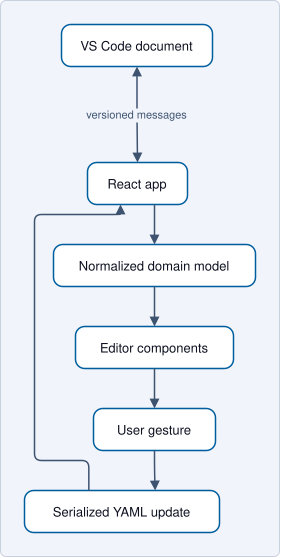
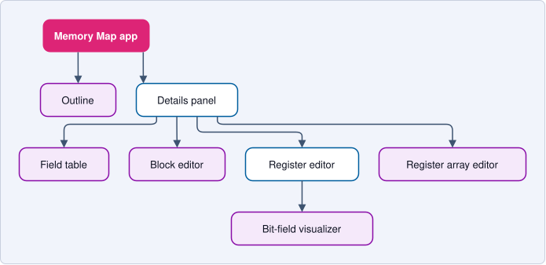

# Webview Architecture

IPCraft has two React applications running in VS Code webviews. A webview is an
embedded browser: it can render the editor interface, but it cannot read project
files or start external tools directly.

| Editor     | Entry point                        | Root element   |
| ---------- | ---------------------------------- | -------------- |
| Memory Map | `src/webview/index.tsx`            | `#root`        |
| IP Core    | `src/webview/ipcore/IpCoreApp.tsx` | `#ipcore-root` |

A third, read-only bundle, `src/webview/systemDiagram/index.tsx`, renders system
designs (`#system-diagram-root`). It is described in
[System diagram application](#system-diagram-application).

## Shared boundary



Both applications use `src/domain/parse.ts` to convert document data into the
editor model and `src/domain/serialize.ts` to remove editor-only values before
writing YAML.

`rowId` identifies a React row across renders. It is never document data.

## Memory Map application

The Memory Map app has three main regions:

- `Outline` selects blocks, registers, arrays, and fields;
- `DetailsPanel` chooses the editor for the selected item;
- visualizers show bit and address layouts.

The table editors for blocks, registers, and fields share
`useTableEditorState`. It combines keyboard navigation, draft protection, and
the pointer insert bar.



Layout calculations belong in pure functions under
`src/webview/algorithms/`. Components request an operation and render the
result; they should not contain separate address or bit-position formulas.

## IP Core application

The IP Core app uses a block-diagram canvas:

- `LibraryPalette` supplies items to add;
- `IpBlockCanvas` draws ports, parameters, clocks, resets, and interfaces;
- `CanvasInspector` edits the current selection;
- `StagingOverlay` reviews generated files before they are accepted.

`useIpCoreState` owns parsed data and validation. `useIpCoreBridge` is the single
typed message boundary: it sends serialized edits and applies the shared
revision filter to incoming document updates. Canvas hooks handle drop,
selection, undo, and keyboard actions.

Host conformance reports are sent as separate `conformanceResult`
notifications tied to the exact source text they validate. They never bypass
the document update filter, and the Issues session ignores a report whose
source revision no longer matches the current YAML.

Generation is asynchronous, so `generateResult` carries the source revision
captured when generation started. The Issues session discards a mismatched
result before changing the report, opening the Issues panel, or focusing a
canvas element. This correlation is separate from document-update revision
filtering: a generation result is an operation response, not a document update.

### Bus contract package boundary

`src/shared/busContracts/index.ts` is the public API used by generators,
parsers, services, and the webview. Its exported modules cover canonicalization,
normalization, resolution, validation, data-lane semantics, and vendor metadata
import. Lower-level expression, constraint, fixpoint, alias, and active-port
modules are implementation details; keeping them behind the barrel prevents
consumers from coupling to intermediate resolver state.

### IP Core dependency and ownership boundaries

Keep the IP Core import direction one-way:

```text
types and pure canvas utilities
  -> editor/message controllers and interaction hooks
  -> feature components
  -> IpBlockCanvas and IpCoreApp composition roots
```

`IpCoreApp` owns top-level composition and lifecycle. It must delegate document
edits, revision-aware messaging, selection commands, session state, and overlay
routing to typed boundaries rather than accumulating raw listeners, YAML path
calculations, or feature state machines.

`IpBlockCanvas` owns canvas composition and rendering coordination. Geometry,
selection transitions, drag and keyboard lifecycles, and model-changing commands
belong in focused pure utilities, hooks, or controllers. Renderer callbacks
request typed actions; they do not independently recreate mutations or
cross-process messages.

Hooks may depend on neutral types and pure utilities, but not on React
components. Move shared types or constants to a dependency-neutral module
instead of importing them from a component. Cross-process messages must pass
through the typed message boundary; do not add isolated `postMessage` calls or
parallel `message` listeners inside feature components.

### Canvas inspector ownership

`CanvasInspector.tsx` owns only the resizable shell, header, footer, and feature
router composition. Selection-specific panels, reusable inspector controls,
message builders, and domain transformations live under
`components/canvas/inspector/`. Panels receive explicit typed props rather than
reading shared mutable module state.

Keep one inspector feature per production module. Aim for no more than roughly
400 lines; 500 lines is the review trigger for extracting controls,
transformations, or a cohesive subfeature. A larger module should retain one
clear responsibility and document why splitting it would make ownership less
clear.

Apply the same size review to other production modules. Line count is evidence
to inspect ownership, not a reason to split cohesive logic into arbitrary
fragments. Generated files, declarative data, and templates are excluded.

## System diagram application

The `systemDiagram` bundle is read-only. It receives a `SystemGraph` from the
host (`graph`, `notRecognized`, or `error` messages) and sends only `ready`,
`revealSource`, and `openDefinition`.

| Layer | Owner |
|---|---|
| Composition root | `SystemDiagramApp.tsx`, `DiagramWorkbench.tsx`, `WorkbenchLayout.tsx` wire the toolbar, outline, canvas, details, and bottom panels |
| Pure layout and geometry | `layout/` (elkjs graph construction, `placementEdges.ts` for which nets place the blocks, `clockResetWires.ts`, `wireRoutes.ts` and `wireTree.ts` (the tree of one net) for the clock and reset wires, node sizing, net badges, bounds, viewport policy, hover placement, panel sizes; `expandedLayout.ts` for hierarchy blocks expanded in place) and `expansion.ts` (which levels, nodes, and selections an expansion shows) |
| Clock and reset analysis | `clocks/`, pure and computed once per graph by `analyzeClocks`: `clockTypes.ts` (the result types), `frequency.ts` (parse and format), `unionFind.ts` and `levelPaths.ts` (small shared helpers), `physicalNets.ts` (nets joined across hierarchy pins, and the driver of each), `clockRules.ts` (declarative clock output, frequency, forwarding, generator, and reset rules; which Vivado IP pins are outputs is the shared `src/domain/knownIpPins.ts`, which the Vivado reader also uses to give those pins the direction `out` with source `rule`), `clockDomains.ts`, `relatedClocks.ts` (clocks of one generator), `pinClocks.ts`, `resetSources.ts`, `crossings.ts`, and the helpers each surface reads: `crossingSummary.ts` (counts and toolbar text), `crossingEdges.ts`, `domainView.ts`, `treeSelection.ts`, `edgeView.ts`, `nodeView.ts` (wire styles, pin marks, node strips), `netTree.ts` and `treeChecks.ts` (the tree rows and checks of Details), `instanceClocks.ts`, `crossingRows.ts` (the texts of its crossing rows), `viewScope.ts` (which domains, resets and crossings the Clocks and Resets tabs list for the level and expanded blocks on screen). `clockDecor.ts` merges them into one description of what the canvas adds to a layout |
| Hooks | `hooks/` (host messages, ELK layout, per-level viewport, navigation with the expanded blocks, pin hover, panel resize; `useSearchHistory.ts` for the search box history, whose pure rules are in `searchHistory.ts` beside `search.ts`; `searchMatcher.ts` compiles the query and its options into the one matcher that the canvas dimming, minimap, counter, stepping and the outline result list share, and that the bottom panel's filter box reuses with the row texts of `panelFilter.ts`) |
| Components | the node, edge, panel, and table components in `src/webview/systemDiagram/`; `FrameNode.tsx` draws a hierarchy block expanded in place; `ClocksTable.tsx` and `ResetsTable.tsx` are the Clocks and Resets tabs, both listing crossings through `CrossingsTable.tsx`, `ClockTreeDetails.tsx` the clock and reset tree in Details, `InstanceClockDetails.tsx` the clocks of a block or port, `AutoDetail.tsx` and `DiagramMinimap.tsx` children of the React Flow canvas (the first sets the far-zoom detail, thresholds in `layout/zoomDetail.ts`; the second is the optional minimap, colored by `minimap.ts`), and `DiagramToolbar.tsx` groups its icon buttons with the shared `ToolbarGroup` and `ToolbarSeparator` (`src/webview/shared/components/Toolbar.tsx`) |

`messageState.ts` keeps the last valid graph when a later message reports an
error or says the file is no longer recognized, so the workbench and the
user's view stay mounted. Layout and viewport decisions are pure functions that
are tested without React.

A view's ELK layout depends on its level, its expanded blocks, and its
isolation, and on no toggle. Its edges are the data and interface nets of the
level, plus the clock and reset edges into a block that has no data edge, so
that block stays next to its driver, and the first clock or reset edge of a
driver that would otherwise have none, which only orders a clock or reset input
port vertically next to one of its loads (`placementEdges.ts`). The boundary pins
of the shown level form two columns by ELK layer constraints
(`layout/boundaryColumns.ts`, used by `boundaryNode`): an input gets
`FIRST_SEPARATE` and `elk.alignment: LEFT`, every other port (output, inout,
unknown direction) gets `LAST_SEPARATE` and `RIGHT`, so the inputs share a left
edge left of every block and the other ports share a right edge right of every
block. ELK rejects a `LAST_SEPARATE` node with an outgoing edge to another
`LAST_SEPARATE` node, so a right-column port that drives another right-column
port (a net with no source endpoint) gets `LAST` instead, which ELK accepts
before a `LAST_SEPARATE` target; it is placed in the last layer, which blocks can
share. In a chain of such ports, where `LAST` to `LAST` would throw, the port
that drives another driver stays unconstrained. The pins of clock and reset nets
reserve a badge label, the net-name label at the end of their wire. ELK routes no
clock or reset wire: after the layout `toFlowElements`
calls `clockResetWires` (`layout/clockResetWires.ts`), which finds the terminals
at the outer ends of the badges and routes one orthogonal tree per net and
level with `layout/wireRoutes.ts` (pure geometry: block columns, channels, gaps,
lanes), around the blocks. Lanes and crossings keep clear of the data wires;
taps cross them. An expanded block's frame reserves room between its pin
labels and its inner blocks (`frameWireChannels` in `layout/expandedLayout.ts`:
a lane per inner clock or reset net ending on that side, at least
`FRAME_WIRE_CHANNEL`), so the inner level has a channel for its trunks. They are ordinary flow
edges (with a junction dot where a branch leaves the tree), listed before the
data wires, so the viewer, the image export, and `ipcraft render` draw the same
wires. A wire that branches off the tree also carries `lead` (the tree path from
the driver to its first point), which the viewer draws with it: React Flow culls
every edge by its own two nodes, so a trunk piece owned by an off-screen wire
would otherwise vanish under the junction dots of wires that are on screen. The
clock and reset wires are never dimmed. See [Clock and reset wires](../concepts/clock-reset-wires.md). The Clocks and resets toggle
only turns on the domain decorations of the clock context (which the
unconnected-pin review pauses). Toggling therefore never runs ELK again, never
moves a block, and never changes the viewport. `isolationSubset` picks its
blocks the same way in every mode: the blocks within N data hops of the
selected ones (`hopDistances`, a BFS over data and interface edges; N is 1 on
every new isolation and is set from the toolbar stepper), with the edges of any
category between two kept blocks at least one of which is closer than N, or
all of them once N reaches the furthest hop (of which the layout draws the
data wires and keeps the clock and reset edges that `placementEdges` selects).
At N = 1 these are the selected blocks and the other end of each data wire.

Auto detail is not a layout input. `AutoDetail.tsx` (inside `<ReactFlow>`)
sets `data-far` on the canvas container from a boolean store selector, so it
re-renders only when the zoom crosses `FAR_ZOOM` (`layout/zoomDetail.ts`), and
keeps `--sd-name-scale` in step through an imperative store subscription;
`systemDiagram.css` hides pin text and scales block names under
`[data-far='true']`. The scale is written only while far and in steps of
`NAME_SCALE_STEP` (`farNameScale`), because changing an inherited custom
property restyles every descendant of the canvas. The minimap is not a layout
input either: `DiagramMinimap.tsx` only draws the nodes the canvas already
holds, so toggling it never moves a block or changes the viewport.

Stable elements: `hooks/useCanvasElements.ts` (the node and edge building of
`DiagramCanvas.tsx`) hands React Flow the previous node and edge object for
every element that draws the same thing (`reuseUnchanged` in
`stableElements.ts`, applied by `hooks/useStableElements.ts`), because React
Flow skips an element whose object it already holds. A search keystroke or a
selection therefore re-renders only the elements that changed. This holds only
while everything put into a node's or edge's `data` is referentially stable
for the elements it does not concern: callbacks are stable (`onSelectNet`
reads the latest handlers from a ref), and per-node values (`selectedNetIds`,
`review`, `domains`, `pinMarks`, `highlightedPins`) are computed in their own
memos and set only on the nodes they apply to.

Dimming is not data: a dimmed block gets the node `className` `sd-dimmed` (the
class of the React Flow wrapper, styled in `systemDiagram.css`), and
`reuseUnchanged` keeps the previous `data` object when only the element around
it changed. `InstanceNode`, `FrameNode` and `BoundaryNode` are `React.memo`, so
such a block does not render its pins again.

`<ReactFlow>` sets `onlyRenderVisibleElements`, so blocks and wires off screen
are not mounted. That only holds if every node carries `measured` (its layout
size) and `handles` (the source and target handle of each pin, from
`layout/nodeHandles.ts`), both set in `toFlowElements`. Without `measured`
React Flow forgets the handle bounds of a node whose object changed and mounts
the node again even off screen. With `measured` alone it would never read the
handles again, so a renamed pin would keep its old handle id and lose its
wire. Explicit `handles` make React Flow build the handle bounds from the
layout every time, so an unmounted or unresized node never needs DOM
measurement and its handle ids always come from the layout (React Flow may
still re-measure a mounted node, which is harmless because the ids match);
they must equal the `<Handle>`s the node components render
(`nodeHandles.test.tsx` compares them). `npm run perf:system-viewer` measures
these paths, including the mounted node count while zoomed in.

## Updates and drafts

Text cells keep an unfinished draft separately from the last valid document
value. This allows users to type partial ranges or numbers without immediately
creating invalid YAML.

When a valid edit is committed:

1. the component requests an update;
2. the domain model is serialized;
3. the webview sends an edit ID and starting document version;
4. the extension host applies or rejects the update;
5. the webview accepts the resulting document version.

See [Data flow](overview.md#data-flow) for the message rules and
[bit field handling](bit-field-handling.md) for structural field edits.

## Shared components

Reusable form and table controls are under `src/webview/shared/components/`.
Shared validation, formatting, focus, and YAML-key helpers are under
`src/webview/shared/utils/`.

Use VS Code theme variables for colors and keep form behavior consistent across
both applications.

## Security

The extension host provides a content security policy that limits scripts,
styles, fonts, and resources to approved extension locations. Webviews send
typed messages for file access and commands. Do not add direct Node.js or file
system assumptions to webview code.

## Contributor checklist

When changing a webview feature:

- identify the owning layer and keep imports flowing toward the composition root;
- extract a focused seam when a change would add another responsibility to a
  root or renderer;
- keep dependencies explicit and avoid hidden module state or broad contexts;
- use one tested implementation for behavior shared by multiple surfaces;
- update both sides of a changed message;
- keep editor-only fields out of serialized YAML;
- use the shared table pattern in all parallel editors;
- put layout calculations in pure algorithm modules;
- preserve one gesture's update and undo boundary during refactors;
- test focus and keyboard behavior in a browser;
- verify narrow and wide editor widths;
- verify light, dark, and high-contrast themes.
