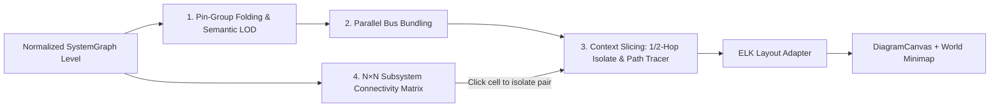

# Large-System Navigation for the Offline System Viewer

## Status

Draft UI/UX proposal for issue #256. Builds on the implemented
[Offline System Viewer](offline-system-viewer.md) and
[Viewing a System Design](../../how-to/view-a-system-design.md).

An interactive prototype with both the baseline problem reproduction and the
proposed navigation controls is in
[offline-system-viewer-mockup.html](offline-system-viewer-mockup.html). Open it
directly in a browser and use the top review bar to switch between
`Proposed UX (Smart Navigation)` and `Problem Baseline (Raw All-Wires)` on the
234-cell, 11-subsystem, 1,172-connection dataset (`radar_soc_top.tcl`).

## Problem

The current system diagram works well on small and medium designs (10 to 30
blocks), where fitting a level keeps zoom above 50% and individual wires can be
followed by eye. Production FPGA systems in Vivado IP Integrator and Intel
Platform Designer (`.qsys`) are an order of magnitude larger:

- **High-fanout interconnects and concentrators.** A single `smartconnect` or
  Qsys interconnect often exposes 16 to 32 AXI master interfaces (`M00_AXI`
  through `M27_AXI`). Stream switches (`axis_switch` 16x16), interrupt
  concatenators (`xlconcat` 16-to-1), and multi-channel DMA or System ILA blocks
  expose 20 to 40 pins each.
- **Hundreds of cells across nested hierarchies.** Multi-channel RF/DSP,
  PCIe/DMA, and Ethernet designs routinely contain 10+ subsystems, 200+
  instances, and 500 to 1,500+ pin-to-pin connections across 3 hierarchy
  levels.
- **Parallel multi-channel buses.** Adjacent subsystems frequently exchange 4,
  8, or 16 parallel AXI4-Stream, AXI-MM, or interrupt nets between the same two
  blocks.

When every pin and every connection is rendered at full detail on a large
level, three compounding failure modes appear:

| Failure mode | Cause | Effect on the user |
|---|---|---|
| **1. Vertical column explosion ("barcode effect")** | Each pin row adds `18 px` (`PIN_ROW_HEIGHT`) to a block's height, and utility blocks (`proc_sys_reset`) and external ports stack vertically in the same column | Column height exceeds `2,500 px`; clicking **Fit** drops zoom to **14-22%**, shrinking all instance and pin labels to unreadable `1.5 px` lines |
| **2. Parallel wire wall ("Venetian blind effect")** | 8 to 28 parallel nets between two columns route through adjacent or coincident vertical channels | Individual wires cannot be traced between source and destination; selecting a single wire highlights one thread inside a dense bundle |
| **3. Loss of spatial context when zoomed in** | Reading `11 px` pin names requires zooming to ~80-100%, where only 3 to 5 blocks fit in the viewport | Following a net across 3 columns requires repeated pan-and-search cycles, losing track of where the signal started |

## Goals and Non-Goals

| Goals | Non-goals |
|---|---|
| Keep full-level **Fit** views legible on levels with 40+ blocks and 200+ connections | Replacing ELK (`elkjs`) as the underlying layered layout engine |
| Compress repetitive numbered pin arrays (`M00_AXI..M27_AXI`, `In0..In15`) without losing access to individual pins | Mutating or persisting folded/bundled UI state back into `.bd`, `.qsys`, or `.tcl` files |
| Coalesce parallel connections between the same block pair into inspectable trunk bundles | Hiding CDC/RDC or unconnected-pin findings when pin groups or bus bundles are folded |
| Let users slice a large level to a 1-hop/2-hop neighborhood or an end-to-end signal path between two endpoints | Running cross-hierarchy shortest-path layout across all levels simultaneously when subsystems are collapsed |
| Provide a tabular subsystem-to-subsystem connectivity overview and a world minimap for spatial orientation | Introducing non-theme colors outside `var(--vscode-*)` |

## Relationship to Existing Viewer Features

The production viewer in `src/webview/systemDiagram/` already implements several
foundations that this proposal extends rather than replaces:

| Existing capability | Current implementation | How this proposal extends it |
|---|---|---|
| Multi-select 1-hop isolation | `src/webview/systemDiagram/isolation.ts` (`isolateLevel`), triggered from the context menu (`Isolate N Selected`) | Adds a toolbar **Isolate** toggle with **1-Hop / 2-Hop** depth switching and a floating canvas banner showing `M of N blocks` |
| In-place subsystem expansion | `src/webview/systemDiagram/expansion.ts` (`expandGraph`) and `FrameNode.tsx` (`+` / `-` header button) | Adds a compact 1-line **inline pipeline preview** (`stage_0 -> stage_1 -> stage_2`) and recursive cell count on collapsed hierarchy blocks so users can see what is inside before expanding |
| Clock and reset wire hiding | `visibleNets` in `src/webview/systemDiagram/model.ts` and net-name badges on pins (`netBadges.ts`) | Also folds clock/reset utility blocks (`proc_sys_reset`) and clock/reset pins out of the default dataflow layout when **Clocks and resets** is off |
| Outline search and stepper | `src/webview/systemDiagram/search.ts` and `useSearchStepper.ts` | Adds outline kind filter pills (`All`, `Subsystems`, `IP / RTL`, `Ports`), recursive subsystem cell counts, and search-hit markers on the world minimap |

## Proposed Navigation Capabilities

### 1. Semantic Level of Detail (`Auto` | `Arch` | `Compact` | `Full pins`) and Pin-Group Folding

High-pin-count blocks are the primary driver of vertical height bloat. The
viewer offers three layout modes (`Compact`, `Arch`, `Full pins`), which set
block geometry, and one zoom-driven drawing mode (`Auto`), which never does:

| Mode | Pin rendering | Block height | When used |
|---|---|---|---|
| `Compact` (default for every design) | Consecutive numbered pin arrays of length >= 4 with the same stem and direction/category fold into a single expandable row (`▸ M00..M27_AXI [28]`, `▸ S00..S15_AXIS [16]`, `▸ In0..15 [16]`) | Reduced by 60-75% on interconnects, switches, concats, and multi-channel IPs | Default interactive working view |
| `Arch` | Individual pins are hidden; blocks render as compact architectural cards (`62-86 px` tall) with interface count pills (`28× AXI`, `8× AXIS`) and a 1-line subsystem stage preview | Fixed compact height (`62-86 px`), raising top-level **Fit** zoom from ~14% to ~48% | System-level block diagram reviews and documentation overviews |
| `Full pins` | Every pin rendered on its own row (`18 px`) | Current behavior | Detailed pin-by-pin inspection |
| `Auto` | Render-only level of detail by viewport zoom scale: below `k < 0.42`, pin labels and net badges are not drawn and block names are enlarged (up to 3x) to stay legible without overlapping their neighbours; at `k >= 0.42`, everything is drawn as usual | Unchanged: the geometry of the chosen layout mode | Continuous semantic zoom |

#### Decisions

| Decision | Rationale |
|---|---|
| **`Compact` is the default for every design**, not only for large levels. A **Compact pins** toolbar toggle switches to `Full pins`. | One predictable default. Folding only acts on arrays of 4 or more pins, so small designs are mostly unchanged, and the same design never opens in a different mode because of a size heuristic. |
| **`Auto` changes only what is drawn, never block geometry.** It does not switch between `Arch`, `Compact`, and `Full pins` while zooming. | A geometry switch re-runs ELK at every threshold crossing and moves blocks under the cursor while the user zooms, which costs layout time on large levels and breaks the zoom anchor. Hiding or rescaling text is a CSS change with no layout run. This also keeps the existing rule that view toggles change what is drawn, never where blocks sit; `Compact`, `Full pins`, `Arch`, and opening a pin group remain explicit user actions that re-run layout, like expanding a hierarchy block in place. |

Rules for **Pin-Group Folding**:

1. **Deterministic stem matching.** A pin name matches `^([A-Za-z_]*?)(\d+)(_[A-Za-z0-9_]+)?$`. Consecutive pins on the same side (`west` or `east`) sharing `(prefix, suffix, direction, category)` with count >= 4 form a foldable group keyed by `${levelPath}|${instancePath}|${side}|${prefix}*${suffix}`.
2. **Click to expand or collapse in place.** Clicking a folded row (`▸ M00..M27_AXI [28]`) expands just that pin array (`▾ M00..M27_AXI [28]` followed by the 28 individual pins) and re-runs layout for the level.
3. **Never hide active findings.** When **Unconnected pins** review is active, or when a pin inside a group has a flagged CDC/RDC crossing or is the active search/focus target, either the group auto-expands or the folded row surfaces the warning badge.

### 2. Smart Bus Bundling (`Bundle buses`)

When two blocks are connected by multiple nets of the same category (for
example, `axi_periph_interconnect_0` driving 12 `S_AXI_P0..11` ports on
`board_mgmt_qsys_sub`, or `rf_frontend_sub` driving 4 `M_AXIS_ADC_0..3` streams
into `rx_dsp_bank_a`), drawing 12 separate orthogonal paths creates visual
noise.

- **Bundling rule.** When **Bundle buses** is active, parallel `LevelEdge`s on
  the current level sharing `(sourceNode, targetNode, category)` with count >= 2
  (excluding clock and reset trees) coalesce into a single bundled edge with a
  midpoint pill badge (`×12 AXI`, `×4 AXIS`, `×8 IRQ`).
- **Fan-in / fan-out ticks.** Where the constituent pins sit on distinct Y
  coordinates (because the pin group is expanded), short `9 px` fan-in/fan-out
  stubs connect the individual pins to the shared trunk. When the pin group is
  folded, the trunk attaches directly to the folded group port.
- **Inspect and unbundle on demand.** Clicking a bundle trunk or its `×N` badge
  selects all constituent nets and opens a **Bundled Bus Trunk** view in the
  Details panel:
  - lists every constituent net, source pin, and target pin (clicking any net
    selects that single net);
  - provides **Unbundle these N wires** to expand that specific `(sourceNode,
    targetNode, category)` pair into individual wires while keeping the rest of
    the diagram bundled;
  - provides **Isolate pair** to slice the canvas to just those two endpoints.

### 3. Context Slicing: 1-Hop / 2-Hop Neighborhood Isolation and End-to-End Path Tracer

Even with compact blocks and bundled trunks, a 234-cell design contains many
independent subsystems that are irrelevant to the question at hand. Two
complementary slicing tools let the developer reduce the active graph on demand:

#### 1-Hop / 2-Hop Neighborhood Isolation

- Extends `isolateLevel` (`src/webview/systemDiagram/isolation.ts`) with a
  configurable hop radius (`hops: 1 | 2`).
- Reachability traverses data, control, interrupt, and interface nets; clock
  and reset nets are ignored unless **Clocks and resets** is enabled, preventing
  a global `FCLK_CLK0` net from pulling every block in the chip into the
  1-hop neighborhood.
- A floating banner at the top of the canvas displays:
  `Isolated neighborhood: <block> · showing M of N blocks [1-Hop] [2-Hop] [Show all N blocks (Esc)]`.

#### End-to-End Path Tracer (`Trace path`)

When investigating dataflow latency, DMA routing, or address reachability (for
example, tracing how samples flow from `jesd_rx_ch0` to `ddr4_mig_subsystem`),
neighborhood isolation around one block is either too narrow (1-hop) or too
wide (2-hop pulls in unrelated branches).

- Clicking **Trace path** opens a floating **Path Tracer** bar with `From` and
  `To` instance/port selectors.
- A breadth-first search (`computePathTrace`) finds the shortest signal chain
  between `From` and `To`, prioritizing high-bandwidth data and control nets
  (`axis`, `avalonst`, `aximm`, `avalonmm`, `interface`) before falling back to
  `interrupt` lines, and excluding global `clock` and `reset` fanout.
- The canvas isolates only the blocks and nets along the traced path, orders
  them left-to-right with step badges (`#1`, `#2`, ..., `#N`), and populates
  the Details panel with a hop-by-hop table (`Hop | From | To | Buses`).

### 4. Macro Orientation: Subsystem Connectivity Matrix, World Minimap, and Layer Filtering

#### Subsystem & Interconnect Connectivity Matrix (`Matrix`)

On levels dominated by crossbar interconnects and 8+ subsystems, an N×N
adjacency matrix is often faster to scan than a 2D node-link diagram:

- Clicking **Matrix** in the toolbar switches the canvas area to an N×N table
  where rows are source blocks/subsystems and columns are destination
  blocks/subsystems.
- Each active cell `(Row -> Col)` displays color-coded interface count pills
  (`4 AXIS`, `8 AXI`, `12 AXI`, `6 IRQ`).
- Clicking any matrix cell exits the matrix and isolates that exact
  `(Row -> Col)` bus pair on the diagram via the Path Tracer.

#### World Radar Minimap

- A collapsible `205 × 145 px` minimap in the bottom-right corner of the canvas
  renders the full level bounding box (`viewBox` over `diagramBounds`), shading
  hierarchy subsystems in green tint, selected blocks in `var(--vscode-focusBorder)`,
  and active search matches in `var(--vscode-editorWarning-foreground)`.
- A live viewport rectangle tracks pan and zoom; clicking or dragging inside
  the minimap teleports the main canvas viewport.

#### Clickable Legend Layer Filters

- The bottom-left legend chips (`AXI-MM`, `AXI4-Stream`, `Interface`,
  `Interrupt`, `Clock`, `Reset`) act as interactive layer toggles:
  - **Click** a chip to toggle visibility of that wire category on the diagram.
  - **Alt+Click** a chip to solo that wire category (hiding all other wire
    categories).

## Architecture and Module Ownership

Following the repository modularity rules in `AGENTS.md` (`types and pure
utilities -> services/controllers/hooks -> components -> application roots`),
each new capability belongs to a focused pure module or component under
`src/webview/systemDiagram/`:

| Module | Layer | Responsibility |
|---|---|---|
| `src/webview/systemDiagram/layout/pinGrouping.ts` (new) | Pure layout utility | Groups consecutive numbered `SystemPin` arrays by stem (`prefix*suffix`, side, direction, category) and produces folded/expanded `PinRow` items for `pinRows.ts` |
| `src/webview/systemDiagram/layout/edgeBundling.ts` (new) | Pure layout utility | Coalesces parallel `LevelEdge` items sharing `(sourceNode, targetNode, category)` into `BundledEdge` descriptors and maps constituent net IDs |
| `src/webview/systemDiagram/isolation.ts` (extend) | Pure graph transform | Adds `hops: 1 \| 2` parameter to `isolateLevel` and adds `computePathTrace(graph, levelPath, fromId, toId)` for shortest-path slicing |
| `src/webview/systemDiagram/connectivityMatrix.ts` (new) | Pure graph projection | Computes the N×N block-to-block interface count table for `levelPath` |
| `src/webview/systemDiagram/ConnectivityMatrixView.tsx` (new) | Component | Renders the N×N adjacency matrix and dispatches pair-isolation actions |
| `src/webview/systemDiagram/DiagramMinimap.tsx` (new) | Component | Renders the collapsible world radar SVG overlay and handles click-to-pan |
| `src/webview/systemDiagram/DiagramToolbar.tsx` (extend) | Component | Adds the `Compact pins` toggle (Phase 1), the `Arch` layout mode and the render-only `Auto` level of detail (Phase 3), `Bundle buses`, `Trace path`, and `Matrix` controls |
| `src/webview/systemDiagram/DetailsPanel.tsx` (extend) | Component | Adds `BundleDetails` (with unbundle action) and `PathTraceDetails` views |

All transformations operate on the existing `SystemGraph` level in the webview
without changing the extension-host parsers (`BdTclReader`, `QsysReader`,
`QsysTclReader`) or the `postMessage` contract.

## Delivery Phases

| Phase | Scope | Primary value |
|---|---|---|
| **Phase 1: Pin-Group Folding & Bus Bundling** | `pinGrouping.ts`, `edgeBundling.ts`, `Compact pins` toggle (on by default), `Bundle buses` toggle, and bundle inspection/unbundling in `DetailsPanel.tsx` | Immediately cuts vertical block height by 60-75% and collapses parallel multi-channel wire walls on existing ELK layouts |
| **Phase 2: 2-Hop Isolation & Path Tracer** | Extend `isolation.ts` with `1-Hop / 2-Hop` banner and `computePathTrace`, plus the floating Path Tracer bar and hop table | Lets users slice a 200+ cell design down to a 5-to-8 block signal chain in two clicks |
| **Phase 3: Architectural LOD, Minimap & Layer Filters** | `Arch` card rendering, render-only `Auto` zoom level of detail, `DiagramMinimap.tsx`, clickable Legend category filters, and Outline kind filters | Makes full-chip overview zoom readable (~50% zoom) and keeps users oriented when panning zoomed-in views |
| **Phase 4: Subsystem Connectivity Matrix** | `connectivityMatrix.ts` and `ConnectivityMatrixView.tsx` with click-to-isolate cell actions | Provides a zero-wire-crossing tabular overview for interconnect-heavy top levels |

## Open Questions

| Question | Options / Notes |
|---|---|
| Hiding `proc_sys_reset` blocks when `Clocks and resets` is off | Hiding reset-only utility blocks saves substantial column height on Vivado designs (which often instantiate one `proc_sys_reset` per clock domain), but must remain discoverable via the Outline and re-appear immediately when `Clocks and resets`, `Clock domains`, or `Unconnected pins` is enabled |
| Bundling across expanded `FrameNode` boundaries | Phase 1 should bundle edges between collapsed blocks on the active level; bundling edges that cross into an in-place expanded `FrameNode` can follow once ELK port-group constraints are characterized |
