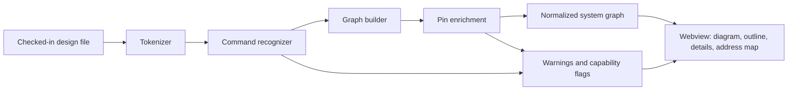

# Offline System Viewer

## Status

Idea with proposed architecture decisions. This document is not yet an
implementation plan.

It narrows one part of
[Design-Aware Documentation](design-aware-documentation.md) into a standalone
feature: a read-only, offline viewer for Vivado IP Integrator block designs and
Platform Designer systems. Both concepts share the same vendor-neutral system
graph. This concept changes the order of that document's MVP. Offline viewing
comes first, because it needs no vendor tool and no license. Batch extraction
through the vendor tool remains a later, optional way to get resolved
(effective) state.

A clickable UI mockup with sample data is in
[offline-system-viewer-mockup.html](offline-system-viewer-mockup.html). Open it
directly in a browser. Its layout and wire routing are a simplified stand-in
for ELK.

## Problem

Opening a large block design or Platform Designer system in the vendor GUI is
slow. Startup, project load, IP catalog refresh, IP upgrade and lock checks,
and validation all run before anything is visible. For a large system this can
take minutes. The vendor tool also needs a local installation and, for many
devices and releases, a license.

Many people only need to understand the design, not change it:

- a reviewer reading a pull request that changes `system.tcl` or `system.bd`;
- a software developer looking up a base address or an interrupt line;
- an RTL developer checking which interconnect port feeds their IP;
- anyone on a machine without the vendor tool or a free license seat.

For these users, the checked-in design files already contain most of the
answer. IPCraft can read those files statically and show the design as a
navigable diagram in VS Code, in seconds, without starting a vendor process.

## Goals and Non-Goals

| Goals | Non-goals |
|---|---|
| Open a checked-in Vivado BD or Platform Designer system without a vendor install or license | Editing the design or writing back to `.bd`, `.qsys`, or Tcl |
| Show hierarchy, instances, connections, external ports, and the address map | Showing default or tool-propagated parameter values that only the vendor tool can compute |
| Navigate: enter hierarchies, search, follow nets, jump to the source line | Validating the design (`validate_bd_design`, Platform Designer validation) |
| Report clearly what the offline view could not resolve | Executing Tcl, sourcing scripts, or running any external command |
| Link IPCraft-managed IP instances to their `.ip.yml` and `.mm.yml` | Matching the vendor GUI's hand-placed layout |

## Relationship to Design-Aware Documentation

| Topic | Design-Aware Documentation | This concept |
|---|---|---|
| System graph | Defines the vendor-neutral normalized graph | Produces the same graph with `partial` capability flags |
| Primary extraction | Vendor tool in batch mode | Static reading of checked-in files |
| Vendor tool | Required for the MVP | Not required; optional future enrichment |
| Tcl | No general interpreter, no sourcing of scripts | Same rule: a static reader recognizes a fixed command set and executes nothing |
| Diagram | Phase 1 deliverable | The whole feature |
| Documentation sidecars | Core feature | Out of scope; can be added on top of the same graph later |

The brainstorm document allows "a clearly marked partial, offline importer only
for formats that can be read reliably without executing untrusted scripts."
This concept is that importer, made a first-class feature.

## Supported Sources

| Source | Vendor flow | What it provides | Completeness | Priority |
|---|---|---|---|---|
| `write_bd_tcl` script | Vivado | Hierarchy, cell VLNVs, user-set `CONFIG.*` values, all connections, external ports, address assignments | Complete topology; parameters are only the user-set ones | P1 |
| `.qsys` (Standard) | Platform Designer | Modules, user-set parameters, connections, exported interfaces, `baseAddress` per connection | Complete topology; parameters are only the user-set ones | P1 |
| `.bd` (JSON, Vivado 2018.3 and later) | Vivado | Same as `write_bd_tcl`, plus some stored interface and address metadata | Structure differs between releases; characterize with fixtures | P2 |
| `.qsys` plus `.ip` files (Pro) | Platform Designer Pro | Instance parameters are stored in per-instance `.ip` files | Must read both; characterize with fixtures | P2 |
| Exported system Tcl (`qsys-script`) | Platform Designer | `add_instance`, `add_connection`, parameter setters | Like `.qsys` | P2 |
| `.hwh` (hardware handoff, also inside `.xsa`) | Vivado, generated | Fully resolved cells, parameters, ports, and memory ranges | Complete, but only exists after generation | P3 |
| `.sopcinfo` | Platform Designer, generated | Resolved modules, parameters, and address map | Complete, but only exists after generation | P3 |

`write_bd_tcl` and `.qsys` come first because they are what most teams keep
under version control. Both describe the design declaratively enough to read
without a vendor tool. Generated files are the most accurate source, so the
viewer should use them when it finds them next to the source. They are never
required.

## Static Reading, Not Execution

The Tcl reader uses the same static evaluation that `HwTclParser` already uses
for `_hw.tcl` files: tokens and lists (`hwTclTokens`, `hwTclLoops`), procs and
argument binding (`hwTclProcs`), conditionals (`hwTclConditionals`), and
expressions (`hwTclExpr`). It recognizes a fixed set of commands and turns them
into graph operations. It never executes anything.

### Vivado `write_bd_tcl` commands

| Command | Effect on the graph |
|---|---|
| `proc create_hier_cell_<name>`, `proc create_root_design` | Scope for a hierarchy level; the body is evaluated with bound arguments |
| `current_bd_instance` | Sets the current hierarchy path |
| `create_bd_cell -type ip -vlnv <vlnv> <name>` | IP instance |
| `create_bd_cell -type hier <name>` | Hierarchy instance |
| `create_bd_cell -type module -reference <module> <name>` | RTL module-reference instance |
| `create_bd_pin`, `create_bd_intf_pin` | Pins on a hierarchy instance |
| `create_bd_port`, `create_bd_intf_port` | External ports, with direction, width, and interface VLNV |
| `set_property -dict [list CONFIG.<key> {<value>} ...] <object>` | User-set parameters on cells and ports (for example `FREQ_HZ`) |
| `connect_bd_net`, `connect_bd_intf_net` | Nets; every endpoint names a `cell/pin` |
| `assign_bd_address` with `-offset`, `-range`, `-target_address_space` | Address segments |
| `get_bd_cells`, `get_bd_pins`, `get_bd_intf_pins`, `get_bd_ports` with literal names | Object references inside the commands above |

The reader skips release checks, `create_project`, `create_bd_design`,
`validate_bd_design`, `save_bd_design`, and layout commands. Each skipped
command is listed as an informational note.

These commands cannot be resolved offline. The reader warns for each one and
marks the affected parts of the graph as `partial`:

| Construct | Why it cannot be resolved offline |
|---|---|
| `apply_bd_automation`, `apply_board_connection` | Vivado creates cells and nets by running rules |
| `source`, `exec`, `open`, file I/O | The viewer never runs or follows scripts |
| `get_bd_*` with `-filter` or other queries of runtime state | The result depends on the design state inside Vivado |
| `foreach` over a list produced by a query | The list is only known inside Vivado |

Exports from `write_bd_tcl` already have automation expanded into explicit
commands, so they read reliably. Hand-written scripts are best effort: the
viewer still shows what it recognized, with the warnings.

### Platform Designer commands and elements

| Source | Elements |
|---|---|
| `.qsys` XML | `module` (name, kind, version, parameters), `connection` (kind, start, end, parameters such as `baseAddress`), `interface` (exported interfaces, `internal` reference) |
| `qsys-script` Tcl | `add_instance`, `set_instance_parameter_value`, `add_connection`, `set_connection_parameter_value`, `add_interface`, `set_interface_property ... EXPORT_OF` |

XML is parsed with the existing `@xmldom/xmldom` dependency. Every graph
element records its source line.

## What the Offline View Can Recover

| Element | `write_bd_tcl` | `.qsys` | How gaps are handled |
|---|---|---|---|
| Hierarchy and instances | Complete | Complete (flat) | None needed |
| Instance type (VLNV or kind) | Complete | Complete | None needed |
| User-set parameters | Complete | Complete | None needed |
| Default and propagated parameters | Not available | Not available | Shown as "not available offline"; generated `.hwh`/`.sopcinfo` if present |
| Connected pins | Complete (from net endpoints) | Complete (from connection endpoints) | None needed |
| Unconnected pins | Not available | Not available | Pin enrichment, otherwise omitted |
| Pin interface type and role | External ports only | From connection kind | Pin enrichment; otherwise inferred from the peer, or unknown |
| Address map | Complete when `assign_bd_address` is present | Base address complete; range needs the slave definition | Range from pin enrichment, otherwise unknown |
| Clocks and resets | Net names, plus `FREQ_HZ` where set | Connection kind and names | Shown as declared; no propagation |

Every pin, parameter, and address segment records its provenance, for example
`connection`, `ip.yml`, `component.xml`, `hw.tcl`, or `hwh`. This lets the
details panel show where a value came from.

## Pin Enrichment

Enrichment fills in pins and interface metadata for instances whose definition
is available as a file. It only reads files and never starts a vendor process.
Sources are tried in order:

1. **IPCraft IP in the workspace.** An `.ip.yml` whose VLNV matches the
   instance gives all ports, bus interfaces, and the memory map.
2. **Module references.** For Vivado `-type module -reference`, the referenced
   RTL is parsed with `VhdlParser` or `VerilogParser`.
3. **User IP repositories.** `component.xml` files indexed by VLNV, read with
   `ComponentXmlParser`.
4. **Installed vendor IP catalogs (opt-in).** If `ipcraft.vivado.installDir` or
   `ipcraft.quartus.installDir` is set, the viewer reads the catalog files
   (`component.xml` for Vivado IP, `_hw.tcl` for Platform Designer IP). This
   reads the installation's files only. It starts no tool and checks out no
   license.
5. **Fallback.** Pins come from net endpoints.

Many vendor IPs change their ports based on parameters. For example, the
number of slave interfaces on an interconnect follows a parameter. Static
reading can evaluate simple parameter-driven presence with the user-set values.
Anything it cannot evaluate is marked `partial` and falls back to the pins seen
in connections.

## Viewer Experience

| Area | Behavior |
|---|---|
| Opening | `Ctrl+Shift+V` (`Cmd+Shift+V` on macOS) toggles between the text and the diagram; see [Opening and Toggling](#opening-and-toggling) |
| Outline | Hierarchy tree with search by instance name, VLNV, or kind |
| Diagram | One hierarchy level at a time. Double-click enters a hierarchy instance; a breadcrumb leads back |
| Nets | Interface nets drawn thick and scalar nets thin. Hovering a net highlights it; "Follow net" lists every endpoint and jumps to it |
| Clock and reset | Hidden by default and shown as pin badges with the net name. A toggle draws them as wires |
| Details | VLNV, user-set parameters, pins with provenance, and the source location |
| Address map | Table of address segments per master address space, sortable and searchable |
| Go to source | Every element opens its source file at the line that created it |
| IPCraft links | Instances backed by an `.ip.yml` open in the IP Core editor; their address segments open the `.mm.yml` |
| Completeness badge | "Offline view, partial" with the capability record and the list of warnings |

The view reloads when the source file changes on disk. It is read-only, so it
does not use the revisioned edit protocol.

### Opening and Toggling

The viewer follows the toggle IPCraft already uses. `Ctrl+Shift+V` switches
`.ip.yml`, `.mm.yml`, and `.ipci.yml` between text and the visual editor
(`openAsVisual` and `openAsText`). It also opens `_hw.tcl`, `component.xml`,
and HDL files in the read-only `fpgaIpCore.sourcePreview` editor
(`previewInIpcraft`). The system diagram uses the same key in the same way.

The diagram replaces the text in the same tab. Go to source opens the Tcl or
`.qsys` text in an editor beside the diagram, so both can be read together.

| Item | Decision |
|---|---|
| Editor | Read-only custom editor `ipcraft.systemDiagram` with `priority: "option"`. Text stays the default, so diffs, blame, and merges are unaffected. Users who want the diagram by default can set `workbench.editorAssociations` |
| Selector | `*.bd`, `*.qsys`, and `*.tcl` |
| Toggle into the diagram | `Ctrl+Shift+V`. Always available for `.bd` and `.qsys`. For `.tcl`, available only when the `ipcraft.isSystemDesignScript` context key is set |
| Toggle back | `ipcraft.systemDiagram` is added to the existing `openAsText` when-clause |

Two rules apply to Tcl:

1. `_hw.tcl` files keep the source preview. The new keybinding's when-clause
   excludes `/_hw\.tcl$/`, so it does not conflict with `previewInIpcraft`.
2. Most Tcl files are not block designs, and a when-clause cannot inspect file
   content. When the active editor changes, the extension sets
   `ipcraft.isSystemDesignScript` after a quick text check for
   `create_bd_design` or `create_bd_cell` (Vivado) and `add_instance`
   (Platform Designer). The shortcut then does nothing on ordinary build
   scripts. "Reopen Editor With..." still offers the diagram for any `.tcl`
   file and shows a clear "not a block design or system script" state when
   nothing is recognized.

## Layout and Rendering

- **Layout:** elkjs, layered algorithm, with fixed port sides (inputs and
  slave interfaces west, outputs and master interfaces east) and orthogonal
  edge routing. Each hierarchy level is laid out separately and cached.
- **Rendering:** `@xyflow/react`, which the Data Inspector already uses for
  pan, zoom, and selection. ELK supplies node, port, and edge positions; the
  nodes are custom components using `var(--vscode-*)` colors.
- **Responsiveness:** ELK runs in a web worker so large levels do not block
  the UI.
- **Dependency:** elkjs, reviewed below.

### Layout Dependency Decision

Reviewed on 2026-11-03. Decision: use elkjs, with the rules below.

| Fact | Detail |
|---|---|
| License | `EPL-2.0` up to 0.11.1; `EPL-2.0 OR GPL-3.0-or-later` from 0.12.0. IPCraft elects EPL-2.0 |
| Effect on IPCraft | EPL-2.0 is file-level copyleft. Unmodified elkjs used only through its API is a separate module, not a Modified Work, so IPCraft stays MIT |
| Obligations for shipping it in the VSIX | Keep the elkjs license and copyright notices, tell recipients where the elkjs source is, and do not restrict their rights to it |
| Gap in the current build | `elk.bundled.js` has no license header, so the `dist/*.js.LICENSE.txt` files that production webpack extracts would not include it. The notice must be added explicitly |
| Precedent | `@mermaid-js/layout-elk` (MIT) depends on `elkjs ^0.12.0`; `sprotty-elk` is used in VS Code extensions |
| Size | `elk.bundled.js` is about 1.6 MB, or about 470 KB gzipped. A production VSIX built on 2026-11-03 was 1.34 MB compressed and 5.03 MB unpacked, against budgets of 2 MiB and 5 MiB. Adding elkjs exceeds the unpacked budget |

Alternatives considered:

| Option | License | Layout quality | Cost |
|---|---|---|---|
| elkjs (chosen) | EPL-2.0, notice required | Ordered ports, hierarchy, orthogonal routing | Size budget increase and a notice file |
| `@dagrejs/dagre` | MIT | No port or hierarchy support; edges attach to node centers and pins need hand-placed fixes | Small dependency, poor fit for block diagrams |
| Custom layered layout | MIT, in-repo | Adequate for small and medium designs, weaker on large ones | Roughly 600 to 900 lines to write and maintain |

Rules for adopting elkjs:

1. Pin `elkjs@0.12.0` and elect EPL-2.0. Do not use a release that is less
   than two weeks old.
2. Use elkjs unmodified. A patched elkjs file would itself be EPL-2.0 and
   would have to be published.
3. Ship a `THIRD_PARTY_NOTICES` file in the VSIX with the elkjs name, version,
   EPL-2.0 text, and source location (`https://github.com/kieler/elkjs`, tag
   0.12.0). Add it to the `scripts/check-vsix.js` allowlist.
4. Load the ELK worker as a separate file only when the system viewer opens, so
   the other editors do not pay for it.
5. Raise the VSIX budgets to 7 MiB unpacked and 2.5 MiB compressed, and record
   the reason in `docs/architecture/vsix-packaging.md` and
   `scripts/check-vsix.js`, as that document requires.

The layout stays behind the pure `elkLayout.ts` adapter. If the larger VSIX
becomes unacceptable, a custom layered layout can replace elkjs without
changing the rest of the viewer. If IPCraft is distributed commercially, legal
review should confirm this reading of EPL-2.0.

Performance targets, to be measured on synthetic fixtures with about 20, 100,
and 500 instances, flat and with three hierarchy levels:

| Operation | Target |
|---|---|
| Parse `write_bd_tcl` or `.qsys` with 500 instances | Less than 1 s |
| First render of the top level | Less than 2 s |
| Enter a hierarchy level | Less than 500 ms after its first layout |

## Architecture

| Module | Location | Responsibility |
|---|---|---|
| System graph types | `src/domain/systemGraph.ts` | `SystemGraph`, `Instance`, `Pin`, `Net`, `AddressSegment`, `SourceLocation`, `Provenance`, `Capabilities`. Pure types shared across the process boundary |
| BD Tcl reader | `src/parser/system/BdTclReader.ts` | Pure: text to graph plus warnings, reusing the `hwTcl*` modules |
| Qsys reader | `src/parser/system/QsysReader.ts` | Pure: XML text to graph plus warnings |
| BD JSON reader | `src/parser/system/BdJsonReader.ts` | Pure, phase 3 |
| Pin enrichment | `src/services/systemGraph/PinEnrichmentService.ts` | File system access, VLNV index, calls to existing parsers |
| Editor provider | `src/providers/SystemDiagramProvider.ts` | Read-only custom editor; watches the source file and posts the graph |
| Webview root | `src/webview/system/` | Composition of outline, diagram, details, and address map |
| Layout adapter | `src/webview/system/layout/elkLayout.ts` | Pure: graph level to ELK input, and ELK output to node and edge positions |

Readers are pure functions from text to graph. File system access and
enrichment stay in the extension host. Only the typed graph crosses to the
webview, as the design-aware documentation concept already requires.

A later CLI command such as `ipcraft system inspect <file> --json` could print
the same graph for CI and scripts.

## Trust and Safety

- The viewer reads files and executes nothing. Tcl is tokenized and matched
  against the recognized commands; anything else is a warning.
- Reading a vendor installation is opt-in through the existing install
  directory settings.
- In an untrusted workspace, only the source file itself is read. Enrichment
  from other workspace files is off.

## Testing

| Level | Coverage |
|---|---|
| Reader unit tests | Golden fixtures: `write_bd_tcl` exports from at least two Vivado releases, `.qsys` from Standard and Pro, including hierarchies, module references, and unsupported constructs |
| Cross-source oracle | For the same design, the topology from `write_bd_tcl`, `.bd`, and `.hwh` must be equal. This catches reader errors without hand-written expectations |
| Fixture generation | Extend the existing Vivado and Quartus integration flows (`scripts/integration/vivado/validate_bd.tcl`, the generated `test.qsys`) to export golden files |
| Enrichment unit tests | VLNV matching, module-reference parsing, parameter-driven pin presence |
| Layout unit tests | Pure ELK adapter: port sides, hierarchy level selection, clock and reset filtering |
| Browser tests | Playwright: enter and leave hierarchies, search, follow net, toggle clocks, go-to-source message |
| Performance | Synthetic 500-instance fixtures checked against the targets above |

## Delivery Phases

| Phase | Scope |
|---|---|
| 1 | `write_bd_tcl` reader, system graph, read-only diagram with hierarchy, outline, details, go to source, pins from connections |
| 2 | `.qsys` Standard reader, address map table, enrichment from `.ip.yml` and module references |
| 3 | `.bd` JSON reader, Platform Designer Pro, vendor catalog and user repository enrichment |
| 4 | `.hwh` and `.sopcinfo` resolved mode; graph diff between two revisions, which feeds the synchronization phase of design-aware documentation |

## Open Questions

| Question | Notes |
|---|---|
| Which Vivado releases to certify first? | Match the release used by the IPCraft Vivado integration tests, plus one earlier release |
| How far to evaluate parameter-driven port presence in vendor `component.xml`? | Start with simple comparisons, mark the rest `partial`, and measure on real IP |
| Should the graph be cached on disk? | Probably not for phase 1; re-parsing is expected to be fast enough. Measure first |
