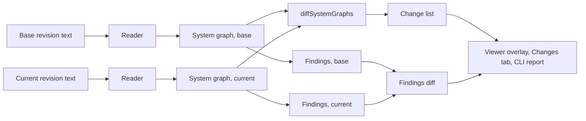

# System Design Diff

## Status

Implemented: every task of [#302](https://github.com/bleviet/ipcraft-vscode/issues/302) is done; the
[Open Questions](#open-questions) remain, and in the viewer the current side is always the open file
(a revision as the current side is available in `ipcraft diff --head` only). The diff engine (`diffSystemGraphs`) and the `ipcraft diff`
command with its Markdown and JSON report work; see
the [command line reference](../../reference/command-line.md#compare-two-revisions-of-a-system-design).
In the viewer, the compare command, the base picker (a git revision or a file)
and the **Changes** tab of phase 1 also work. The current side is the open file.
A block that is only renamed, and one that is only moved to another level, is reported as one change (see
[Renames and Moves](#renames-and-moves)). The findings diff (new and resolved
unconnected pins and clock or reset crossings) is implemented in the engine and
in `ipcraft diff`, and the **Findings** tab of the viewer lists them; the viewer
checks the current side with the workspace definitions and a base that is a git
revision with the definitions as they were at that revision, `ipcraft diff` with the
design files alone. `ipcraft diff --fail-on changes|new-findings` exits with 1
for use in CI. The **Address map** tab marks added, changed and removed segments. On the
diagram, the marks of everything that exists in the current revision
(blocks, pins, new wires, counts on hierarchies, the outline, the legend, Details, the
**Marks**, **Changes only** and **Show version-only changes** buttons) are implemented, and the viewer's
exported images carry them while Marks is on. What was removed is drawn as ghosts, laid out
with the union of both revisions, with the **Show removed** toggle (see [Layout](#layout) for
the decision and its measurement); exported images (while Show removed is on too) and
`ipcraft diff --image <file.svg|png|jpg>` draw the ghosts as well, laid out with the same union. A file that was renamed since the base revision is read under its
old path, and one that did not exist there is compared as all added, in `ipcraft diff`
and in the viewer. This document describes
how the [system viewer](../../how-to/view-a-system-design.md) could show what
changed between two revisions of a block design or Platform Designer system.

It turns the "graph diff between two revisions" of phase 4 in
[Offline System Viewer](offline-system-viewer.md) into a feature of its own.
The same diff later feeds the synchronization phase of
[Design-Aware Documentation](design-aware-documentation.md).

A clickable UI mockup with sample data is in
[system-design-diff-mockup.html](system-design-diff-mockup.html). Open it
directly in a browser. Its blocks are placed by hand; the viewer would lay them
out with ELK.

One decision is made: the changes are drawn as an **overlay on one diagram**,
not as two diagrams side by side. See [Why an overlay](#why-an-overlay).

## Problem

The first user named in the system viewer concept is the reviewer of a pull
request that changes `system.tcl` or `system.bd`. The viewer shows that reviewer
one state of the design. It does not show what the pull request changed.

The text diff of these files does not answer the question either:

- A `.bd` or `write_bd_tcl` file reorders and renames things when Vivado saves
  it. One new block can move hundreds of lines.
- An IP upgrade touches the version string of every upgraded block.
- A rewired pin is two edited lines far apart, with nothing that links them.
- The effect of a change is not in the text at all: a new clock domain
  crossing, an input that is no longer driven, an address that moved.

So reviewers either trust the author or open both revisions in the vendor tool
and compare by eye.

## Goals and Non-Goals

| Goals | Non-goals |
|---|---|
| Show what changed between two revisions of one design file, in terms of blocks, pins, connections, parameters and addresses | A text diff, or a replacement for the SCM diff editor |
| Ignore changes that have no meaning for the design: order, line numbers, net names, tool metadata | Merging two revisions or resolving conflicts |
| Show the effect of the change on the findings the viewer already computes (unconnected pins, clock and reset crossings) | Timing, resource or functional comparison |
| Work offline, without a vendor tool, for every format the viewer reads | Reading the old revision with a vendor tool |
| Give the same result on the command line, for continuous integration and pull request comments | Comparing two unrelated designs |

## What Is Compared

Both revisions are read by the existing readers into a
[`SystemGraph`](../../../src/domain/systemGraph.ts). A pure function compares
the two graphs. The text is not compared.



### Identity

A change can only be named when the same thing is found in both graphs.

| Element | Identity | Compared |
|---|---|---|
| Instance | Its path, for example `/dsp_pipeline/fir_0` | Kind, type (VLNV, component or module reference), parameters, pins |
| Pin | Owner path and pin name | What it connects to. For the pins of a hierarchy block also direction, signal type, interface type, width and parameters |
| External port | Level and name | What it connects to, direction, signal type, interface type, width and parameters |
| Connection | The pin, not the net | The set of pins on the same net |
| Address segment | Address space and segment | Offset and range |
| Parameter | Owner and key | Value |

**Connections are compared per pin, not per net.** Vivado renames nets freely
(`axi_dma_0_M_AXIS` becomes `S_AXIS_1` after an unrelated edit), and a net that
gains one load is still the same wire for every other pin on it. For each pin
the diff compares the set of pins it shares a net with. A net name appears only
as a label.

Only the pin that moved is reported, not the pins it joined or left. A
difference is dropped when it is a pin of an added or removed block (the block
already says so). Of what remains, a pin that kept some of its connections is
not reported when every pin it gained or lost kept fewer connections than it
did: it is a host that gained or lost a neighbour, and the neighbour is the
change. A pin that kept nothing, or that is as well connected as the one that
joined, is reported. An added or removed block lists its connected pins.

A hierarchy pin has two views: the outside one, on the nets of the level that contains the hierarchy, and the inside one, on the nets of the hierarchy's own level (a feed-through inside the hierarchy changes only the inside view). Both are compared by the same rules, and the inside view is listed as its own change of the hierarchy block.

### Kinds of Change

| Change | Example | Shown as |
|---|---|---|
| Instance added or removed | `axis_data_fifo_0` is new | Added, removed |
| Version only | `xlconcat:2.1` to `xlconcat:2.2`, nothing else | Its own quiet kind, can be hidden |
| Type changed | `axi_gpio` replaced by `axi_iic` under the same name | Changed |
| Parameter changed | `c_s2mm_burst_size` 64 to 256 | Changed, with both values |
| Block renamed | `axi_gpio_0` is now `axi_gpio_main`, nothing else | One row, old and new name |
| Block moved to another level | `fifo_0` moved from the top level into `dsp_pipeline` | One row, old and new path, then its rewired pins |
| Pin rewired | `S_AXIS_S2MM` now fed by the FIFO | Changed, with old and new peers |
| Pin added or removed | `M01_AXI` of an interconnect is gone | On its instance |
| Address segment added, removed or moved | `0x4120_0000` freed | Address map tab |
| Change inside a hierarchy | Two changes in `dsp_pipeline` | Count on the hierarchy block |

Version-only changes get their own kind because an IP upgrade is the most
common noise in a pull request. A reviewer can hide them with one toggle and
still see that they are there.

### What Is Ignored

- Line numbers, order of instances, nets and pins.
- Net names.
- Diagnostics of the reader.
- Anything the two sources do not both know. See
  [Two different formats](#two-different-formats).

### Renames and Moves

An instance is identified by its path, so a renamed instance, or one moved to
another hierarchy, has a new path. By identity it is one removed and one added
instance, and everything that carries its name changes with it: its address
segments (their texts start with the path), and the peers of the pins it is
connected to. One typo fixed in a block name gave 22 rows in the Markdown report.

The diff pairs a removed and an added instance as a rename only when all of
these hold:

- they are in the same level (a rename in place; a move to another level is a
  separate pairing, see below), and that level exists in both revisions, so only
  the topmost block of a renamed hierarchy is a candidate;
- same kind, same type with its version, same parameters, same pin names;
- they are the only removed and the only added instance with these properties in
  that level (two identical candidates on a side are ambiguous, and not guessed);
- with the removed instance renamed, the diff has no change left at or below
  the added instance: after applying the rename the diff reports no change on
  the block, and for a hierarchy nor inside it (connections to added or removed
  blocks, and neighbours that only joined or left one of its nets, do not count).

The candidate pairs are verified together, not one after another, so the result
does not depend on the names or on any order: all pairs are applied to the base
at once and the diff is taken once; every pair with a change at or below its
added instance is dropped, and the rest starts again from the original base,
until no pair is dropped. The address segments and the connections of other
blocks that differed only by the name are then no longer reported, and the Base
column shows the names the base had. A renamed hierarchy is one change; its children are not
listed. A block that is renamed and also changed stays removed plus added. A wrong
rename hides a real change, so the rule prefers to miss a rename. Detection never hides a change. It can show a connection
change that the diff without it attributed to the removed and the added block. A block that only lost or gained a neighbour may no longer be listed; the change then shows on that neighbour.

A block that moved to another level is paired the same way, after the renames, from
what they left unpaired. A move is the same block under another parent level with
the **same last name**; a block that is moved and renamed at once stays removed plus
added. The removed and the added instance must have the same name, kind, type with
its version, parameters and pin names, in different parents; each is the topmost
block of its subtree (its parent is not itself a removed or an added instance), and
they are the only such pair with that signature. All pairs are applied to the base
at once: the block, and everything below it for a hierarchy, takes the new path, the
child lists of the old and the new level follow, and net endpoints follow the path.
Nets stay on the level they were on, so the pins of the moved block see their old
neighbours through absolute pin identity, and a move that rewired a connection (the
usual case, because a connection crossing a hierarchy goes through its boundary pins)
reports it. A pair is kept when, in that diff, nothing differs strictly below the
moved block (its subtree is identical) and the block itself has no change but its
pins: no parameter, type or attribute change. Failing pairs are dropped and the rest
starts again from the original base, as for renames, so the result is order-free.
A move is one change: `moved`, with the old path (`basePath`), the new path, and the
connection changes of the block as its pins. The Base column of the report shows
the old path and the base side of a pin the names and levels the base had. The
neighbours that were rewired are listed from their side, as for any rewired pin.
The pairing keeps its limits on purpose: a block moved into a hierarchy that is
itself new (wrapping blocks in a new hierarchy) is not paired, because the added
block lies below an added hierarchy. Renames are paired first, without the moves. If
the moves would change a block that was paired as a rename (a moved block is connected to
it), the moves connected to that block are dropped; the others stay (if none can be told, all moves fall back to removed plus added). A moved block that
is identical to a block renamed in its destination level makes that rename ambiguous (two
added blocks of one signature in that level), and the rename is then lost. A deleted block
and an identically configured new block of the same name in another level are reported as
moved, because the identity of an instance beyond its path (`xci_name`, say) is not in the
graph. The findings diff does not apply moves
(the review of unconnected pins is per level, and the nets of a moved block stay on
their old level in the moved base), so a finding of a moved block can show as both
resolved and new.

### Two Different Formats

Comparing a `write_bd_tcl` script with a `.bd` of the same design is useful
when a team switches from one to the other. A `.bd` knows more: declared pins of
module references, more pin directions. The diff compares only what both graphs
know. A pin that exists in one graph because only that format declares it is
not a change. The report states that the two revisions use different formats.

### Findings

The viewer already computes unconnected pins and clock and reset domain
crossings for one graph. The diff runs them for both graphs and compares the
results by their pins:

- **New:** in the current revision only. "This change adds 1 undriven pin."
- **Resolved:** in the base revision only.
- Findings present in both are not listed.

This is the line a reviewer most needs, and no text diff can give it.

In `ipcraft diff` no workspace definitions are read: findings come from the design
files alone. In the viewer the current side uses the definitions of the workspace
(`.ip.yml`, HDL, `.qsys`), and a base that is a git revision uses them as they were at
that revision, so a finding can appear because a definition changed, not the design.
The Findings tab says where the definitions come from. Only the definitions the design
matches (by the working tree's index) are read from git, so a definition that exists
only at the revision, or whose VLNV or name changed since, is not found; a base that is
a file, or a design that did not exist at the revision, uses the working tree's
definitions or none.

## Viewer Experience

See the [mockup](system-design-diff-mockup.html).

### Why an Overlay

| | Overlay on one diagram | Side by side |
|---|---|---|
| Finding the same block in both states | Not needed | By eye; layouts differ between revisions |
| Screen space | One diagram | Half each |
| Removed things | Need a place (ghosts) | Natural |
| Reuse of the viewer | Full: panels, search, isolate, export | Two canvases to keep in step |

The overlay wins because the two layouts are not the same: one added block
moves its neighbours, so side by side the reviewer has to match blocks by name.
The cost of the overlay is that removed blocks need a position. See
[Layout](#layout).

### On the Diagram

The diagram shows the **current** revision, with marks. Every mark is a color
and a sign, so it does not depend on color alone.

| Mark | Meaning | Drawing |
|---|---|---|
| `+` | Added | Solid border in the added color |
| `−` | Removed | Dashed border, name struck through (a ghost) |
| `~` | Changed | Border in the changed color; changed pin names in the same color |
| `v` | Version only | Muted border |
| none | Unchanged | Dimmed |

- An added wire is drawn solid in the added color, a removed wire dashed in the
  removed color. A rewired pin so shows both its old and its new connection.
- A hierarchy block shows the number of changes inside it (`~ 2 inside`), as it
  shows crossings today. The outline shows the same counts.
- Clock and reset wires are dimmed unless they changed.

### Toolbar

- **Compare ... with ...**: the current side and the base. See [Choosing the base](#choosing-the-base).
- A summary: `+2 −3 ~4 v1`.
- **Changes only**: hides what did not change, using the isolate view (the
  changed blocks and one connection around them).
- **Show removed**: shows or hides the ghosts. Offered when the base has something the current design lacks; **Marks** off hides them too.
- **Version only**: marks or ignores version-only changes.
- **Exit compare**: back to the plain diagram.

### Panels

- **Changes** (new bottom tab): one row per change with its kind, what changed,
  the level, and the base and current value. A click goes to the level, selects
  the block and centres it. The filter box of the bottom panel works on it.
- **Address map**: in compare mode it marks added, removed and moved segments.
- **Findings** (new bottom tab, compare mode only): new and resolved findings.
- **Details**: for a selected block, the parameters and connections that
  changed, each with the base and the current value, and a count of what did
  not change.

Search, levels, expand in place, the minimap and image export work as in the
plain viewer. An exported image keeps the marks, so it can go into a pull
request.

### Choosing the Base

| Situation | Default base |
|---|---|
| The file has uncommitted changes | `HEAD` |
| No uncommitted changes, on a branch | The merge base with the default branch |
| Otherwise | The user picks |

The picker offers `HEAD`, the merge base, branches, tags and a commit.

The current side is the working tree by default, and it can be a git revision
too. Both sides are then read from git, and the file on disk plays no part:

| Compare | Use |
|---|---|
| Working tree with a revision | What did I change? |
| Revision with revision, for example `main` with `feature/fifo`, or `v1.4.0` with `v1.5.0` | Review a branch or a pull request without checking it out; see what changed between two releases |
| File with file on disk (**Compare with File**) | Designs outside git, or two exported copies |

When the current side is a revision, the diagram is read-only history: go to
source opens the file at that revision, and the diagram does not follow edits
of the file on disk.

A file that was renamed or moved between the two revisions is looked up under
its old path, using the rename detection of git (`git diff-index -M` / `git diff-tree -M` for the command
line, the `diffWith` of the git extension for the viewer). A file that did not
exist in the base is compared with an empty design, so everything is added. Both
say so in the report line, the JSON `base` (`path`, `missing`) and the Changes
bar.

Entry points:

- **IPCraft: Compare System Design with...** on an open design file or diagram.
- A button in the diagram toolbar.
- The context menu of a changed design file in the Source Control view.

The base text is read through the built-in git extension API. Nothing is
checked out and no process of a vendor tool runs. In an untrusted workspace the
compare works, without workspace definitions, as the plain viewer does.

### Layout

The removed blocks need positions, and the diagram should not jump when the
compare is turned on.

Decided: lay out the **union** of both graphs (the current graph plus the
removed instances, pins and wires) with ELK. Ghosts then sit where their
neighbours pull them, and wires to them are routed like any other wire. The union
is computed with the diff (`unionAdditions`, see [Architecture](#architecture)): the
removed blocks, the removed external ports, the connections of the base that the
current graph does not have (one ghost net per base net, cut to the pins that exist in
the union and grouped by what the current graph still connects, so a lost connection is
drawn once and a kept one is not repeated) and the pins a block that stays lost (the
interconnect port of a removed slave), which the ghost wires need as ends. A removed
hierarchy is one ghost block. Clock and reset nets are left out of the ghosts: the viewer
draws them as badges and routes them apart, and the Changes tab lists them.

The union layout differs from the plain layout of the current revision. So
entering compare mode moves blocks once. That is acceptable: it is a different
view, and it stays stable while toggles change (**Show removed**, **Marks** and **Version
only** only change what is drawn; blocks never move, as with the other toggles
of the viewer). Hiding the ghosts leaves their space free.

**Measurement.** Before the decision, the real ELK pipeline laid out the plain graph
and the union graph of each pair, and compared the places of the blocks that both have
(the unchanged ones). Displacement is a fraction of the diagonal of the plain
layout.

| Pairs | Median displacement | Order |
|---|---|---|
| The fixture pairs of the diff with a removal: the Vivado `.bd` pair (a block and a port removed) and the Platform Designer pair (a port and a wire); the rename and move pairs have no ghost, so no block moves | 0.07 in both (mean 0.07 and 0.10, largest 0.17 and 0.16) | Left to right order kept; no block changes column |
| 7 small designs (3 to 14 blocks) with 1 or 3 blocks removed, spread over the design | 0.02 to 0.18 | Columns kept, except one design (3 of 8 removed: 40% of the pairs of blocks change columns) |
| The same, removing the most connected blocks (13 cases) | 0.04 to 0.80; above 0.25 in 4 of 13, where the hub gone changes the whole design | At most 11% of the pairs change columns |
| Generated designs of 60 and 400 blocks, 1, 3 and 10 removed (12 cases) | 0.12 to 0.40 | At most 11% of the pairs change columns; the order inside a column differs for 29% to 66% of the pairs |

What decided it: on a pull request that removes one or two blocks, an unchanged block moves by
a tenth of the diagram, stays in its column and keeps its neighbours. Larger numbers
come from designs where ELK reshuffles the order inside the columns for any edit:
laying out the **base** and the **current** graphs plain, with no ghost at all, moves the unchanged
blocks of the generated designs by the same amount (median 0.20 to 0.40), so the union adds no
instability of its own. Inserting the ghosts at their place in the base order instead of at the end
of their level was no consistent improvement. Pinning the positions of the unchanged blocks
was not needed, and was not built. The measurement is on fixtures and on designs edited by removing
blocks; real pull requests are still to be measured.

## Command Line

```text
ipcraft diff <design> --base <git ref>                    compare the working tree with a revision
ipcraft diff <design> --base <git ref> --head <git ref>   compare two revisions
ipcraft diff <base file> <current file>                   compare two files
```

| Option | Effect |
|---|---|
| `--format markdown\|json` | Report format; Markdown is the default |
| `--out <file>` | Write the report to a file instead of standard output |
| `--image <file.svg\|png\|jpg>` | Also render the overlay of the top level |
| `--ignore-version-only` | Leave version-only changes out |
| `--fail-on new-findings\|changes` | Exit with 1 when there are new findings, or any change |

The Markdown report is made for a pull request comment: the summary line, the
new and resolved findings, the address map changes, then the other changes
grouped by level. A GitHub Action that runs the command and posts the comment
reaches reviewers who do not use VS Code.

The JSON report is the change list as the viewer uses it, so other tools can
build on it.

## Architecture

| Module | Responsibility |
|---|---|
| `src/domain/systemGraphDiff.ts` (types) | `SystemGraphDiff`: the change list. JSON-serializable, like the graph |
| `src/services/systemDiagram/diff/` (pure) | `diffSystemGraphs(base, current)`, rename pairing, findings diff, union graph for layout. No `vscode`, no DOM |
| `src/services/systemDiagram/` | Reads the base revision (git API or file), runs the readers and enrichment for both sides. The extension does not use the git API yet |
| `src/providers/SystemDiagramProvider.ts` | Sends the diff with the graph; one new message |
| `src/webview/systemDiagram/` | Marks on nodes and wires, Changes and Findings tabs, compare toolbar |
| `src/cli/diff.ts` | The command, Markdown and JSON reports |

The diff is computed in the extension host and in the CLI by the same pure
code. The webview receives the current graph, the union additions and the
change list; it does not compute the diff.

The unconnected-pin and clock analyses (`unconnectedPins.ts`,
`clocks/analyzeClocks.ts`) are pure functions in `src/webview/systemDiagram/`.
The image renderer and the CLI already import pure modules from that folder, so
the findings diff can call them from the extension host and the CLI as they
are. No move is needed first.

## Trust and Safety

- Both revisions are read as text. Nothing is executed, as in the plain viewer.
- The base revision comes from the local git object store. No network access.
- A base revision that cannot be read (it does not exist, git fails, or the
  text is not a system design) gives a clear message. A file that did not exist
  in the base is not an error: it is shown as all added, and said so. A path
  that exists in neither the working tree nor the base is an error.

## Testing

- **Diff engine:** unit tests on small graph pairs, one per kind of change and
  per ignore rule, plus the rename rule and its refusals.
- **Fixture pairs:** hand-written `before`/`after` design files for each format.
- **Real histories:** commit pairs from public repositories that changed a
  `.bd` or a block design script, run through an opt-in test as for the `.bd`
  reader. They are third-party files and stay out of this repository.
- **Viewer:** component tests for the marks, tabs and toggles; a browser test
  for the jump from a change row.
- **CLI:** golden Markdown and JSON reports for the fixture pairs.

## Delivery Phases

| Phase | Scope | Useful on its own |
|---|---|---|
| 1 | Diff engine, **Changes** tab, compare the working tree or a revision with a picked revision, `ipcraft diff` with Markdown | Yes: a reviewer gets the change list |
| 2 | Overlay on the diagram: marks, ghosts, union layout, **Changes only** | Yes |
| 3 | Findings diff, address map diff, JSON report, `--fail-on` | Yes |
| 4 | Rename pairing, pull request Action, compare of two different formats | Yes |

## Open Questions

| Question | Notes |
|---|---|
| Union layout, or the plain layout with ghosts placed afterwards? | Resolved: the union layout. Measured on the fixture pairs and on edited and generated designs, see [Layout](#layout). Real pull requests are still to be measured |
| Should a change inside a non-descended IP (for example an `axi_interconnect` in a `.bd`) be reported? | The graph does not hold its inside, so today it cannot be |
| How are grafted Platform Designer subsystems compared when the subsystem file changed but the top file did not? | The compare is per design file; the subsystem files of the base revision must be read from the same revision. Done in the viewer for a base that is a git revision |
| Should definitions (`.ip.yml`, HDL) be read from the base revision too? | Resolved for the viewer: the base revision reads the definitions the design matches from git and the Findings tab says so. `ipcraft diff` reads none |
| Is three-way compare (base, ours, theirs) needed for merge conflicts? | Out of scope until asked for |
