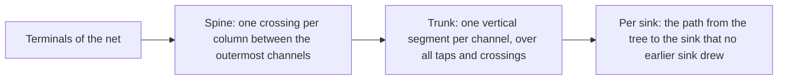

# Clock and Reset Wires

The system viewer and the image export draw clock and reset nets as wires, routed over the data-flow placement by a small router of our own instead of ELK (issue #283).

## Why not ELK

Blocks are placed from data and interface nets only (issue #261, `placementEdges.ts`). ELK's layered layout puts every edge target in a later column than its source, so any clock or reset edge handed to ELK takes part in choosing the columns. Measured on the root levels of the fixtures, against the current placement:

| Design | Current (w x h, data wire px) | All edges to ELK | Second pass, edges oriented along the data columns |
|---|---|---|---|
| `zynq_dma_system` | 2521 x 577, 9566 | 2391 x 673, 13611 | 2959 x 703, 11131 |
| `versal_clocks` | 1417 x 528, 735 | 2233 x 405, 2071 | 2821 x 393, 2212 |
| `vivado_dsp_soc_8ch` | 4005 x 2657, 67220 | 4052 x 2869, 86643 | 4075 x 3763, 90815 |

ELK also draws one edge per sink, so a clock with 400 loads costs 400 routed edges. The router below keeps the placement untouched and costs a few percent of the ELK layout time.

## What is drawn

| Element | Rule |
|---|---|
| Blocks and data wires | Unchanged: placed and routed by ELK from data and interface nets. |
| Clock and reset net | One orthogonal tree per net and level, from the driver to every sink the level shows. |
| Badge | Stays, as the net-name label at each wire end. The wire starts just past the drawn text of the badge, so it never runs through it. |
| Junction dot | Where a branch leaves the tree. Two wires that cross without a dot are not connected. |
| Expanded hierarchy block | The inner level is routed inside the frame; its boundary pins are the frame pins. The frame keeps a wire channel between its pin labels and its inner blocks: 24 px (`FRAME_WIRE_CHANNEL`), or more when the clock and reset nets on that side need more lanes. |
| Isolated view | Only the clock and reset edges the isolation keeps are routed. |

The viewer, **Export image** and `ipcraft render` share `toFlowElements`, so all three draw the same wires.

## Columns and channels

ELK's layered layout puts the blocks of a level in columns (its layers). The column of a block is found from the laid-out geometry: the x extents of the node bounds (`nodeBounds`, box plus badges) are merged where they overlap, and each merged interval is one column.

- A **channel** is the free vertical strip between two columns, plus one before the first column and one after the last. A level with `n` columns has channels `0..n`.
- A **gap** is the free horizontal strip between two vertically adjacent blocks of a column, plus the open space above the first and below the last.

`elk.separateConnectedComponents` is off so that the columns hold for the whole level. With it on, ELK lays out each connected group of blocks on its own and packs the groups side by side, and their columns interleave (on `versal_clocks` the smallest channel was 11 px, on `subsystem_two_clocks` all blocks merged into one column). Turning it off costs no layout time and changes the size of those fixtures by under 2 percent.

## Routing one net

A **terminal** is the point where a wire meets a pin: the end of the drawn badge text, at the pin's height. It leaves towards the west or the east. A frame pin seen from the inner level has no badge on the inside. The strip where the frame draws its pin labels is an obstacle of the inner level, so no trunk or crossing runs through a label; the terminal is on the inner edge of the strip and leaves inwards, and the wire end is then extended to the frame border at the pin's height, below the label. The channel of a terminal is the first channel in the direction it leaves.

1. **Spine.** Walking from the driver's channel outwards in both directions, as far as the outermost channel with a terminal, the net crosses each column through a gap. The crossing height is the free position nearest to the previous height (the driver's height at the start).
2. **Trunks.** In every channel the net uses, one vertical trunk spans all its terminals and crossings there. Each terminal reaches the trunk by a horizontal tap at its own height. The tap is clear of blocks because a block's badges never overlap another block of its column.
3. **Lanes.** Each net gets its own x position in a channel, 6 px apart and at least 4 px from the vertical segments of the data wires in that channel. The nets of a channel are in graph order, except that a net tapping from the left column is placed left of a net tapping from the right column at the same height, so two facing taps never run over each other. When a channel has fewer free positions than nets, the nets are spread evenly over it instead. Crossings in a gap are 6 px from each other and at least 4 px from the horizontal data wires that cross the column and from the heights of the terminals in the two channels beside it. A crossing also keeps 6 px from the crossings of the two neighbouring columns, which share a channel with it.

A pin that sits on two clock or reset nets is the terminal of both, so their taps share a line from the pin to the first trunk. This is the one case where wires of different nets overlap.
4. **Wires.** The tree is cut into one polyline per sink: sinks are taken nearest first, and each draws its path towards the driver until it meets a part an earlier sink drew. Every wire except the first of a net starts on the tree and gets the junction dot at its first point.

A wire is an ordinary flow edge (`${net.id}#${endpointIndex}`), so selection, highlight colors, the selected clock tree, dimming, and isolation treat it like a data wire.

## Modules

| Module | Responsibility |
|---|---|
| `layout/wireRoutes.ts` | Pure geometry: columns, channels, gaps, lanes, and the spine and trunks of one net. Knows boxes, terminals, and polylines only. |
| `layout/wireTree.ts` | The tree of one net as points, and its cut into one polyline per sink. |
| `layout/clockResetWires.ts` | Builds the terminals and routing requests of each drawn level from the flow nodes and the graph, and turns the routes into flow edges. |
| `layout/elkLayout.ts` | `toFlowElements` adds the wires before the data wires, so data wires paint on top; `separateConnectedComponents` is off. |
| `ElkEdge.tsx`, `shared/render/systemLevelSvg.ts` | Draw the junction dot. |

## Performance

The router sorts the node boxes once per level. Per net it does work close to proportional to its terminals, plus a binary search over the gaps and occupied heights of each column it crosses. Measured results are recorded in issue #283.
