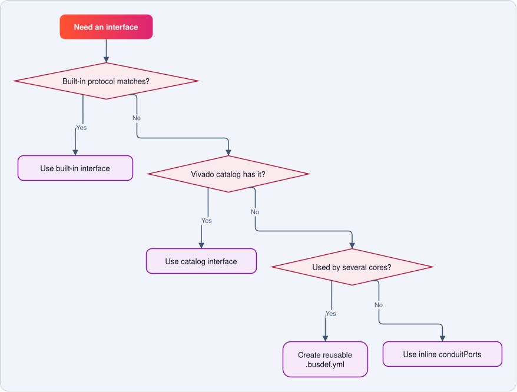
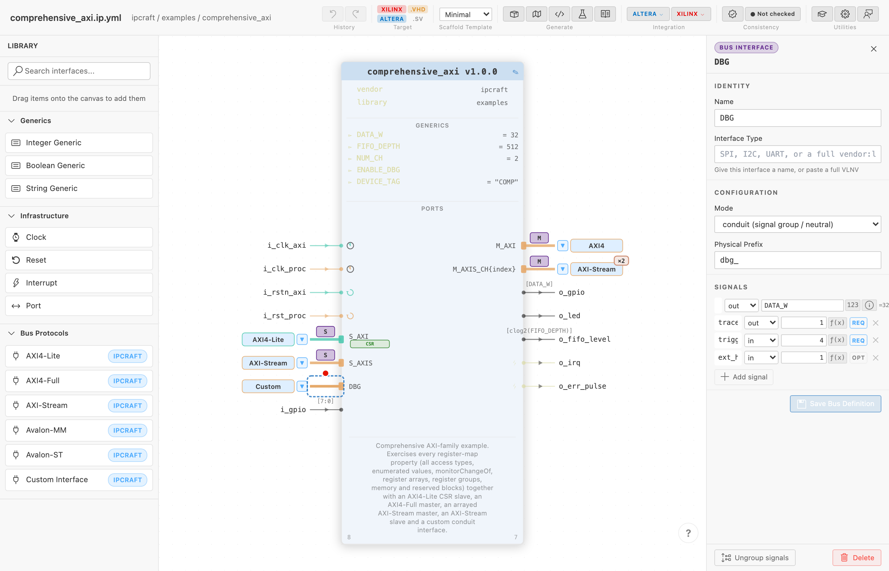
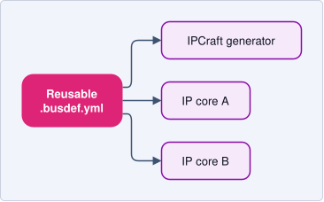

# Custom Interfaces

A custom interface is a named group of signals that does not follow one of
IPCraft's built-in protocols, such as a proprietary streaming link or a
diagnostic port. A **conduit** is such a group with no implied bus transaction.

Use a built-in interface (AXI, Avalon) or one from the
[Vivado interface catalog](../concepts/vivado-interface-catalog.md) when one
matches: vendor tools then understand the interface and can connect it
automatically. Use a custom interface for everything else.

| Interface | Signal list | Tool understanding |
|---|---|---|
| AXI or Avalon | Fixed by the protocol | Vivado or Quartus understands the bus |
| Vivado catalog | Supplied by Vivado | Vivado understands the interface identity |
| Custom | Defined by you | Tools keep the group but may not connect it automatically |



## Add the interface

1. In an `.ip.yml` open in the IP Core editor, find **Custom Interface** under
   **Bus Protocols** in the library on the left.
2. Drag it onto the edge of the core block.
3. Select the new interface; the inspector opens on the right.



## Configure it

In the inspector's **Configuration** section:

| Field | What it controls |
|---|---|
| Mode | `conduit` for a signal group without transactions; `master` or `slave` when one side clearly initiates |
| Physical Prefix | HDL signal prefix, for example `dbg_` gives `dbg_trace_data` |
| Interface Type | Empty for a one-off conduit, or vendor, library, name, and version for a reusable identity |

`slave` and `conduit` interfaces are drawn on the left of the block, `master`
interfaces on the right.

## Add signals

In the **Signals** section, select **Add signal** for each wire:

| Field | Meaning |
|---|---|
| Direction | `in`, `out`, or `inout`, seen from this interface's mode; the opposite mode sees the reverse |
| Name | Appears in the RTL port list as `<physicalPrefix><name>` |
| Width | A number or a parameter name; empty for one bit |
| Presence | `REQ` (always generated) or `OPT` (generated only when the core enables it); click the badge to toggle |

The signals are stored inline in the `.ip.yml`:

```yaml
busInterfaces:
  - name: DIAG_OUT
    type: ipcraft:busif:conduit:1.0
    mode: conduit
    physicalPrefix: diag_
    conduitPorts:
      - name: ENABLE
        direction: in
      - name: SAMPLE
        direction: out
        width: 12
      - name: STATUS
        direction: out
        width: 3
```

## Reuse across IP cores

An inline interface belongs to one core. To share the same signals between
cores:

1. Select the interface and select **Save Bus Definition** in the inspector.
2. Choose a name. IPCraft writes `<name>.busdef.yml` and switches the interface
   to reference it.
3. In another core, add a **Custom Interface** and pick the saved definition.

Files named `*.busdef.yml` anywhere in the workspace are discovered
automatically and offered as interface types. A core can also point to a folder
of definitions with `useBusLibrary`. Editing a `.busdef.yml` updates every core
that uses it.



## Generated vendor files

| Target | Result |
|---|---|
| Vivado, interface with its own type | A bus definition and abstraction definition XML pair under `busdef/`, one pair per type however many interfaces use it |
| Vivado, generic `ipcraft:busif:conduit:1.0` | No bus interface: Vivado has no conduit concept, so the signals become plain ports in `component.xml` |
| Quartus Platform Designer | A `conduit` interface; the signals stay grouped, but Platform Designer does not connect them by protocol |

Importing a `component.xml` back gives plain ports for a generic conduit,
because the grouping cannot be recovered. Avalon-MM ports that Vivado's
`avalon_rtl` does not declare (`chipselect`, `debugaccess`, and their
active-low forms) are also plain ports in `component.xml`, but the importer
folds them back into the Avalon-MM interface.

## Next steps

- [Vivado interface catalog](../concepts/vivado-interface-catalog.md): check
  whether Vivado already describes your protocol
- [Creating your first IP core](create-your-first-ip-core.md): standard bus
  interfaces, clocks, resets, and ports
