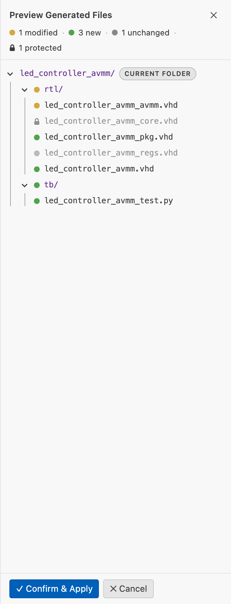
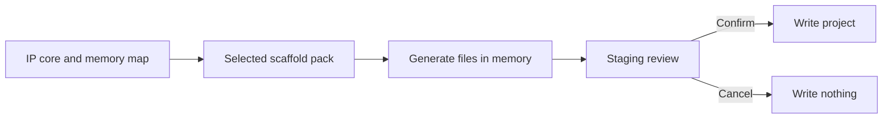

# Generating a Project

Scaffolding means creating a project structure from an IP core description. The
selected scaffold pack controls the exact files.

## Generate the complete project

1. Open an `.ip.yml` file.
2. Choose the HDL language, vendor targets, and scaffold pack in the toolbar.
3. Run **IPCraft: Scaffold Project**.
4. Review the staged files.
5. Select **Confirm and Apply**.



Nothing is written before confirmation.

| Staged state | Meaning |
|---|---|
| New | File will be created |
| Modified | Existing content will change |
| Unchanged | No write is needed |
| Protected | User-owned file is excluded unless explicitly selected |

Use **View Diff** on a modified file before accepting it. A protected file comes
from a rule or file-set entry with `managed: false`. A file-set `managed: false` file is compared only once it
exists on disk; before that IPCraft never generates it.



## Generate one part

| Command | Output |
|---|---|
| **Generate Top-Level HDL** | RTL selected by the pack |
| **Generate Cocotb Testbench** | Python tests and simulator files |
| **Generate Documentation** | Markdown supplied by the pack |
| **Generate Vivado Project** | Vivado Tcl scripts and constraints |
| **Generate Quartus Project** | Quartus Tcl script and constraints |
| **Generate Altera Platform Designer Component** | `_hw.tcl` component |
| **Generate Xilinx Vivado Component** | `component.xml` and XGUI files |

Use a focused command when you intentionally want to leave other generated
areas untouched.

## Review staged files

Each modified file has an action that decides what **Confirm and Apply** does
with it. Hover a row to change it.

| Action | Effect |
|---|---|
| Auto-merge | Writes a three-way merge of the generator output into your edits. Offered only when the merge has no conflicts. |
| Sync interface | Replaces only the entity or module header (generics, ports) with the generated one and keeps everything else in your file. Offered for HDL files whose interface differs. |
| Overwrite | Replaces the file with the generated content. |
| Keep | Leaves the file on disk unchanged. |

The default is Overwrite for unedited files and Auto-merge when your edits
merge cleanly. It is Keep when your edits conflict with the generator output, when
the generator output did not change, and for every protected (`managed: false`)
file: a protected file is never written unless you pick another action
yourself. **Merge** is separate: it opens the file in the three-way merge
editor, and the file is then skipped by Apply.

Two badges explain why a file needs attention:

- **Hand-edited**: the file differs from what IPCraft last generated.
- **Interface out of date: +N/-M/~K**: the generated entity or module has N
  added, M removed, and K changed ports or generics compared with the file on
  disk. Hover the badge to list the names.

After **Sync interface**, the entity is up to date but new ports are not yet
used. Connect them in the architecture or module body yourself.

IPCraft finds hand edits by comparing the file with a baseline, the content it
last generated. Baselines are stored in `.ipcraft/baseline/` inside the output
folder, mirroring the generated paths. Commit this folder so teammates and CI
share the same merge base. It is not listed in `fileSets`. Without a baseline
(for example, the first run on an existing project), edits cannot be detected
and a modified file defaults to Overwrite unless it is protected.

## Typical output

```text
generated-core/
├── rtl/       HDL and register logic
├── tb/        generated tests
├── docs/      generated core documentation
├── xilinx/    Vivado packaging and project files
└── altera/    Quartus and Platform Designer files
```

Small scaffold packs may produce only one or two of these directories.

## Important settings

| Setting | Meaning |
|---|---|
| `ipcraft.generate.targets` | Vendor outputs to include |
| `ipcraft.generate.hdlLanguage` | VHDL or SystemVerilog |
| `ipcraft.generate.includeTestbench` | Whether complete scaffolding includes tests |
| `ipcraft.generate.includeDocs` | Whether complete scaffolding includes documentation |
| `ipcraft.generate.scaffoldPack` | Workspace fallback pack |

The pack selected in the IP core takes priority over the workspace fallback.

## After generation

1. Review changes in version control.
2. Add custom logic only to files intended to be user-owned.
3. Compile the generated HDL.
4. Run the generated tests.
5. Run a Vivado or Quartus build when vendor files changed.

If a pack regenerates a file that users edit, mark that output `managed: false`
before relying on it for hand-written logic.

## Troubleshooting

| Problem | Check |
|---|---|
| Empty or missing register logic | Linked memory map and `memoryMapRef` |
| Wrong bus wrapper | Interface type and mode |
| Vendor files missing | Selected targets or vendor-specific command |
| Template missing | Pack's `source` name and built-in fallback |
| Hand-written changes would be replaced | Staging diff and `managed: false` |
| Generated test misses RTL files | Complete `fileSets` entries in the IP core |

See the [generator reference](../reference/generator.md) for output options and
[scaffold packs](customizing-generated-files-with-scaffold-packs.md) for custom layouts.
