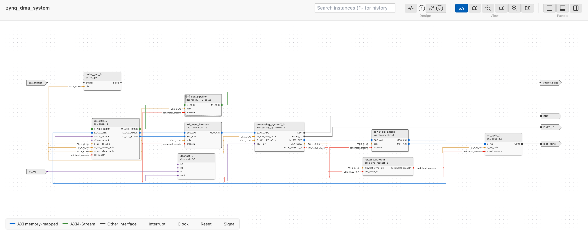
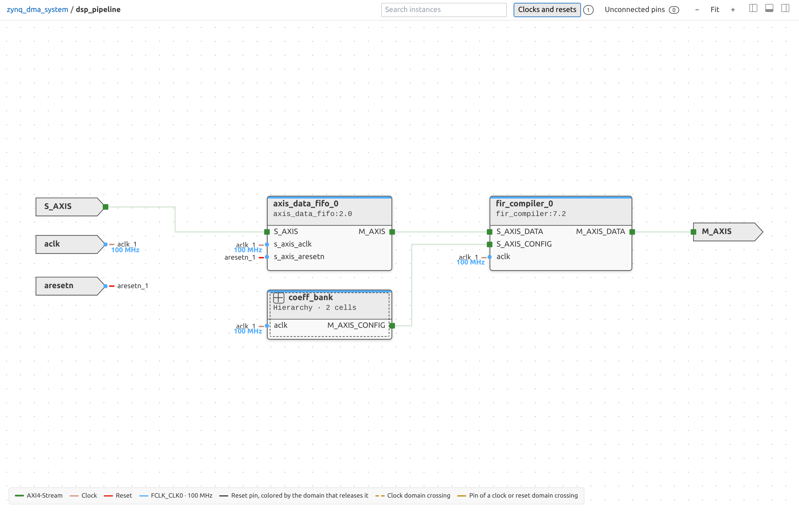
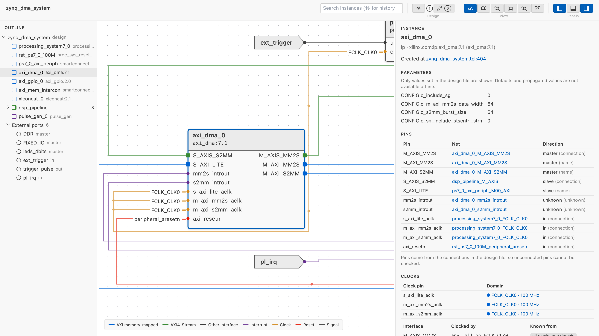
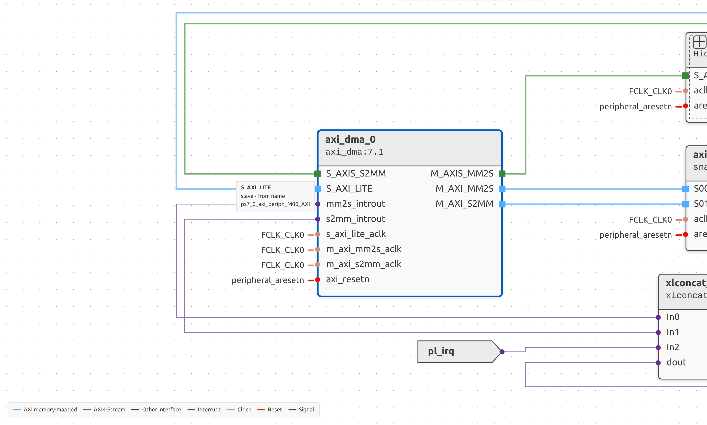
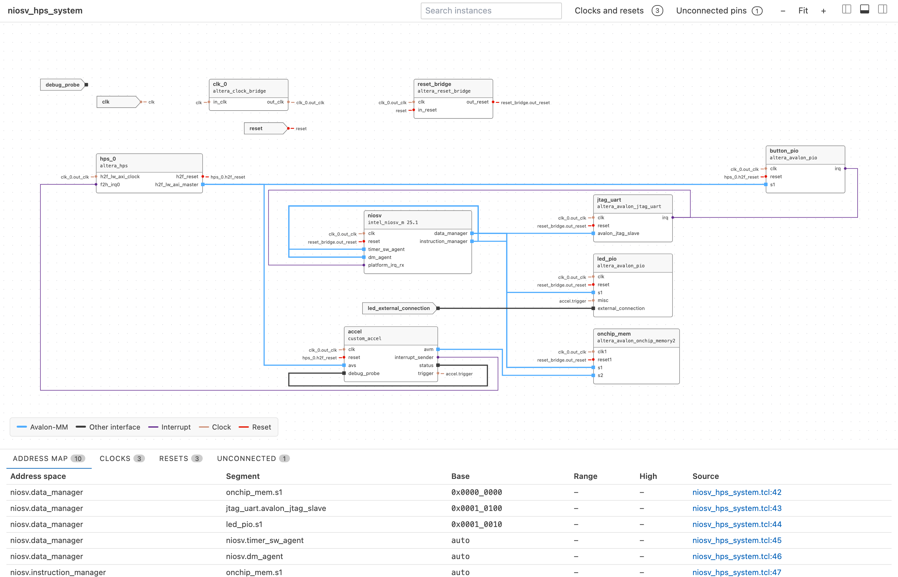

# Viewing a System Design

IPCraft can show a Vivado block design or a Platform Designer system as a
diagram. The view is read-only and works offline. It needs no vendor tool and
no license, and it never runs your script.

## Supported files

| File | Source |
|---|---|
| `.tcl` | Vivado block design script written by `write_bd_tcl` |
| `.bd` | Vivado block design file (JSON, Vivado 2018.3 and later) |
| `.qsys` | Platform Designer system (Standard) |
| `.tcl` | Platform Designer system script for `qsys-script` |

IPCraft recognizes a `.tcl` file by its commands. A `_hw.tcl` file is a
component description, not a system. It keeps its own preview.

Files are read as text. The Tcl is never executed, so values that a script
computes are not available. See [What the offline view cannot
show](#what-the-offline-view-cannot-show).

## Open the diagram

1. Open the `.tcl`, `.bd` or `.qsys` file in the text editor.
2. Press `Ctrl+Shift+V` (`Cmd+Shift+V` on macOS), or run **IPCraft: Open as
   System Diagram**.
3. Press the same keys again to return to the text editor.

The diagram updates as you edit the file. If an edit breaks the file, the
diagram keeps the last valid design and shows a banner with the reason.

## Navigate

The diagram shows one hierarchy level at a time.

The toolbar buttons are icons in three groups: **Design** (Clocks and resets, Unconnected pins, Compare), **View** (Simplify zoomed out, Minimap, zoom out, Fit, zoom in) and **Panels**. Hover a button to see its name.

- **Levels.** Double-click a hierarchy block to enter it. Use the breadcrumb at
  the top left, or the mouse back button, to go up one level. The mouse forward
  button returns to the levels you left with the back button, one at a time,
  until you go to another level some other way.
- **Expand in place.** Click the **+** button in the header of a hierarchy block,
  or right-click it and choose **Expand In-Place**, to see inside without leaving
  the level. The block becomes a frame with its pins on the border: wires from
  outside meet the pins from outside, and the wires inside meet them from
  inside. Click **-** in the frame header, or right-click and choose
  **Collapse**, to fold it again. The block stays where it is on screen when it opens into a
  frame, and when you fold it again. **Open Subsystem** in the same menu enters the
  block like a double-click. Hierarchy blocks inside a frame can be expanded
  too, and expanded blocks stay expanded when you go to another level and back.
  Isolate works on the blocks of the level on show, not on those inside a frame.
- **Outline.** Lists the instances of the current design and its external
  ports. Select an item to select it in the diagram and center it. While a
  search is on, it lists the search results instead.
- **Search.** Type in **Search instances** to dim the blocks whose name or
  type does not match. The outline opens and lists every match on every
  level under its hierarchy blocks, which are shown muted when they do not
  match themselves; click a result to go to it. Clear the search to get the
  full outline back. `*` stands for any characters and `?` for one character,
  so `axi*fifo` finds `axis_data_fifo_0`. The **Match Case** and **Match
  Whole Word** buttons next to the box narrow the matches: with **Match Whole
  Word**, `count` finds a block named `count` but not `count_0`, and
  `count*` finds both. Press Enter or Shift+Enter to go to the next or
  previous match on any level; a counter shows the position, and Escape
  clears the search. As in the VS Code text editor, Ctrl+F (Cmd+F on macOS)
  moves to the search box from anywhere in the viewer with its text selected,
  filled in with the name of the selected block unless the search already
  matches it, and F3 or Shift+F3 goes to the next or previous match.
  Up and Down in the search box go through your earlier searches, as in the
  VS Code find box. A search is remembered when you step through its matches
  or leave the box, and the history lasts while the viewer is open.
- **Details.** Shows the selected block, net, or port: type, where it is
  defined in the file, the parameters set in the file, and its pins with their
  nets. Select a line link to open the file at that line.
- **Address map.** Lists the address segments found in the design. Select a
  row to select its instance.
- **Clocks.** Lists the clock domains with their frequencies and the clock
  domain crossings. See [Clock and reset domains](#clock-and-reset-domains).
- **Resets.** Lists the reset sources and the reset domain crossings.
- **Filter a bottom panel tab.** The box at the right of the tabs lists only
  the rows of the tab on show that have its text in a column, ignoring case,
  with `*` for any characters and `?` for one. Each tab keeps its own filter,
  the tab counts stay those of the design, and Escape clears the box.

## Isolate blocks

To focus on a few blocks of a busy level, select them and isolate them.

1. Click a block or port, then Cmd+Click (macOS) or Ctrl+Click (Windows and Linux) to add more, or to remove one that is already selected. Details shows "N selected" with a list of the names; clicking a name selects that block alone.
2. Right-click one of the selected blocks and choose **Isolate N Selected** (N is the number of selected blocks). Right-clicking a block that is not selected selects it alone, and the item reads **Isolate Selection**.

The diagram then shows the selected blocks, the wires that touch them, and the block or port at the other end of each of those wires, laid out compactly. Wires between two of the other blocks stay hidden, unless 1-hop already shows everything connected to the selection. Clock and reset nets bring in no block of their own; their wires are drawn only between the blocks that are shown, with badges on the pins. A toolbar chip reads "Isolated · N selected · M of T shown", where M counts the blocks and ports on screen and T those of the level. Next to it, **+** shows the blocks one connection further out (the chip reads "2-hop", "3-hop", and so on), and **-** removes the outermost ring again. **+** stops, and the chip adds "all connected", once every connected block and every wire between them is shown (the wires between the outermost blocks appear at that last step). With the canvas focused (click empty canvas), the `+` and `-` keys do the same. Isolating again, including a different selection from inside an isolated view, always starts at 1-hop; clicking blocks without isolating keeps the view and its radius. Clock and reset nets never bring in a block, at any step.

Choose **Show All** from the right-click menu (on a block or on the empty canvas) or the toolbar to return to the full level, with the zoom and pan it had before. Isolation also ends when you go to another level (breadcrumb, opening a hierarchy block, the mouse back button, or an outline or search jump) or when a search step or outline row selects a block that the isolated view hides.

## Find unconnected pins

To review the pins that nothing connects to, turn on **Unconnected pins** in the toolbar. The button shows the number of unconnected pins in the whole design, in the warning color when any is undriven. Turning it on also opens the **Unconnected** tab of the bottom panel; turning it off leaves the tab as it is.

Turning the review on or off does not move any block, and it does not change **Clocks and resets**. While both are on, the clock domain colors, frequencies, and markers are paused until you turn the review off. A pin is unconnected when no net touches it on its level. There are two kinds:

- **Undriven**: an input (or a slave interface) that nothing drives. The vendor tool ties such an input to a constant, usually its default value, so an active-low reset tied to 0 holds the block in reset. Undriven pins are drawn in the warning color.
- **Unused**: an output, master interface, or bidirectional pin that nothing uses. This is often intentional, so unused pins are drawn muted.

While the review is on, the diagram dims wires and blocks without findings. Each unconnected pin gets a short dashed stub ending in a hollow circle, a block header shows a warning icon (a disconnect icon when nothing is undriven) with the count, and hovering it gives the undriven and unused split (hierarchy blocks count the pins inside them too). The outline shows a count on each block and external port.

Only blocks whose full pin list is known can be checked: blocks with an `.ip.yml` or HDL definition, hierarchy blocks and their pins, module references of a `.bd` file (the file lists all their ports), and external ports. For the other blocks (drawn with a dashed border), the viewer knows only the pins that appear in connections, so it cannot tell which pins are open. They are listed as not checked.

The **Unconnected** tab lists every finding with its pin, block, level, direction, type, where the pin is known from, and a link to the line that created it. The **Undriven** and **Unused** chips filter the rows. Click a row to go to its level, select the block, centre it (zooming in if it is too small to read), and mark the pin on the diagram and in Details. A hierarchy pin that is open on both sides is listed twice: once on the hierarchy block in the parent level and once as the port inside. Details shows `undriven` or `unused` in the Net column of every unconnected pin of a block whose full pin list is known, with or without the review on.

## Panels

The outline, details, and bottom panels start hidden so the diagram has the
full width. Use the three buttons at the top right to show or hide them. Drag
the edge of a panel to resize it. For the arrow-key resize and the double-click
that collapses a panel, see [Keyboard Shortcuts](../reference/keyboard-shortcuts.md#system-diagram).

## Clocks and resets

Clock and reset nets are drawn as wires, one tree per net, from the driver to
every load on the level. A small dot marks where a branch leaves the tree; two
wires that cross without a dot are not connected. The wires are routed around
the blocks, in the gaps between them. Each pin that is on one of these nets
shows a badge with the net name at the end of its wire, or the first name and
`+N` when the pin is on several nets. Blocks are placed by their data and
interface connections, so the clock and reset wires never move them. The
external ports of the level form two columns: input ports on the left of every
block; output, bidirectional and unknown-direction ports on the right, ordered
to keep the wires short. A Platform Designer conduit export counts as an input
(`conduit end`) or an output (`conduit start`) unless the `.ip.yml` of the
exporting component makes its direction clear: when all its conduit signals are
outputs, or all are inputs, the export uses that direction. A block with no data
connection on the level, such as a clocking wizard or a reset block, sits next to
the block that drives its clock or reset.

Turn on **Clocks and resets** in the toolbar to color the clock and reset pins
by clock domain, with the frequencies, crossings, and other markers described
in [Clock and reset domains](#clock-and-reset-domains). The badges and wires stay, and the
blocks stay in place when you turn it on or off: the toggle only adds or
removes the domain markers.

The count chip next to the toggle is always shown. It reads the number of
flagged crossings (`2 CDC · 2 RDC`, in the warning color), or the number of clock
domains when none is flagged, for the whole design. Click the chip to open the
**Clocks** tab of the bottom panel, expanding the panel if it is hidden; this
does not turn **Clocks and resets** on or off, and turning it on does not open
the tab.

## Clock and reset domains

To see which clock each part of the design runs on, and where a signal passes
from one clock to another, turn on **Clocks and resets** in the toolbar. The
chip next to it shows the number of flagged crossings (`2 CDC · 2 RDC`, in the
warning color), or the number of clock domains when none is flagged; click it to
open the **Clocks** tab. The **Unconnected pins** review can be on at the same
time: it pauses the domain colors, frequencies, and markers. Turn the review off
and the domain decorations return. Neither toggle moves a block.

A clock domain is a clock source and every pin its nets reach, followed through
hierarchy pins and, in Platform Designer, through clock source blocks. What
matters is which pins share one clock; the frequency is extra information.

### The source of a clock

Vivado's exported script does not list the driver of a net first, so IPCraft
does not take the first pin of a net as its source. The source is the one pin
that a rule names as a clock output (for example `FCLK_CLK<n>` of a Zynq PS,
`clk_out<n>` of a clocking wizard, `pl<n>_ref_clk` of Versal CIPS) or whose
direction the design or an `.ip.yml` states, such as an input port of the
design. When there is none or more than one, the source is not known: the
domain is still there, named after the first net of the clock, and Details says
"Source not known". A reset source is found the same way, from the rules for
reset outputs. The output of an `xlconstant` is a constant that never toggles,
so the sinks of a reset tied to it are **OK** ("Tied to a constant"). The
outputs of `util_vector_logic`, `util_reduced_logic` and `axi_gpio`
(`gpio_io_o`, `gpio2_io_o`) are known to drive a reset, but no rule says which
clock releases it, so its sinks are **Not checked**. A reset net without a known
source is still a reset source, named after its first net, with every pin on it
as a sink; an asynchronous input still passes, and every other sink is **Not
checked**.

Status outputs of clocking blocks, such as `locked` of a clocking wizard or
`dcm_locked` of a `proc_sys_reset`, are not clocks even when their net is named
like one. They belong to no domain and are drawn as ordinary nets.

### Frequencies

A frequency is shown only when the design file sets it, never from a vendor
default, and the word "unknown" is never printed for it: a domain without a
frequency shows its name alone, and Details says "Frequency not set in the
script." It is the requested value: Vivado can round the output of a processing
system or a clocking wizard during validation, and the achieved frequency is not
available offline.

| Clock source | Value read |
|---|---|
| Zynq-7000 `processing_system7`, pin `FCLK_CLK<n>` | `CONFIG.PCW_FPGA<n>_PERIPHERAL_FREQMHZ` |
| Zynq UltraScale+ `zynq_ultra_ps_e`, pin `pl_clk<n>` | `CONFIG.PSU__CRL_APB__PL<n>_REF_CTRL__FREQMHZ` |
| Clocking Wizard `clk_wiz`, pin `clk_out<n>` | `CONFIG.CLKOUT<n>_REQUESTED_OUT_FREQ` |
| Platform Designer `clock_source` | `clockFrequency` |
| External port or hierarchy pin | `CONFIG.FREQ_HZ`, or the `-freq_hz` flag of `create_bd_port` / `create_bd_pin` that Vivado writes in exported scripts |

When the parameter is not set, or the source has no rule, no frequency is shown.
An `.ip.yml` clock can declare the frequency it expects (`frequency`); Details
then checks it against the domain it sits on.

### On the diagram

While **Clocks and resets** is on and the **Unconnected pins** review is off:

- The markers of clock pins take the color of their domain, and each clock pin
  of a domain with a frequency shows it next to the pin.
- The markers of reset pins take the color of the domain that releases the
  reset; an asynchronous reset, or one whose release clock is unknown, is muted.
- Data wires are dimmed, except the wires of a clock domain crossing, which are
  drawn dashed in the warning color. Clock and reset wires are not dimmed.
- The names of the pins at the ends of a crossing turn to the warning color:
  both ends of a clock domain crossing, only the sink pin of a reset domain
  crossing.
- A block header has a thin strip with one segment per clock domain of the block
  and a badge: `N CDC · M RDC` when crossings are on its pins (inside a hierarchy
  block, anywhere inside it), or `N DOMAINS` when it spans several domains.
- The legend lists the domains of the level, and the outline shows a dot per
  domain on each block and the number of crossings inside each hierarchy block.
  Connections between related clocks are not counted or drawn as crossings.

### Select a clock or reset net

Selecting a clock or reset net, with **Clocks and resets** on or off, selects its whole tree
on every level: the pins and badges of the tree are highlighted, the blocks and
ports it does not touch are dimmed, and the clock pins of a clock tree show the
frequency. Details shows the tree:

- a **clock tree** with the frequency and the parameter it was requested by and
  where (or "Frequency not set in the script."), the tree from the source
  through every level with a check against the
  `.ip.yml` expectation where there is one, the resets released on that domain,
  the crossings with other domains, and the blocks that have clocks on another
  domain too;
- a **reset tree** with who releases the reset, a check per sink (`✓` released
  on its own clock, `✗` clocked by another domain, `?` clock unknown, `✓`
  asynchronous input), and the reset domain crossings.

Selecting a block shows its clock pins with their domains, and for a block with a
known pin list the clock of each interface and the release of each reset. A
clock or reset port shows its domain.

### Crossings

IPCraft checks memory-mapped and streaming connections (AXI, Avalon) and resets,
followed through hierarchies.

- A **clock domain crossing (CDC)** is a connection whose two ends are clocked by
  different domains. No synchronizer is known between them: IPCraft does not look
  inside blocks.
- A **reset domain crossing (RDC)** is a reset sink that is clocked by a domain
  other than the one that releases the reset, or a reset that is asynchronous
  (the Zynq PS resets) feeding a sink that does not accept an asynchronous reset.
  A `proc_sys_reset` accepts one on `ext_reset_in` and `aux_reset_in`.
- A connection between **related clocks** is neither flagged nor unchecked. The
  outputs of one clocking wizard (`clk_wiz`, `clk_wizard`) are related, and so
  is the clock that feeds its input (`clk_in1`, `clk_in2`, ...): Vivado times
  the paths between them. Neither the Clocks nor the Resets tab lists it; Details of its net
  says **Related clocks**, with the generator in its reason. Processor system
  clocks are never treated as related.
- A **block that spans domains** (for example an asynchronous FIFO) is not
  flagged. Its header badge reads `N DOMAINS`, and its Details say "This block
  uses N clock domains" with their names.
- A crossing is **not checked** when the clock of one end is unknown, when both
  clocks enter the design through ports, or when the source of one clock is not
  known. Two clocks that enter through ports may be one clock: the top level
  that uses the design decides. A port clock against a clock made inside the
  design (a PS clock, a clocking wizard output) is still a crossing.

The clock of an interface or reset pin is never guessed from its name. It comes
from the `associatedClock` of its `.ip.yml`, from the only clock of its block,
or from all clocks of its block being on one domain. For an external port it
comes from the `CONFIG.ASSOCIATED_BUSIF` and `CONFIG.ASSOCIATED_RESET`
parameters of a clock port. Otherwise the pin is not checked; the **Clocks** tab
and Details say why.

Platform Designer inserts clock-crossing adapters and reset synchronizers when it
generates the system, so its crossings are **OK**, "Handled by Platform
Designer", and neither tab lists any. The domains and frequencies are shown
as for any other system.

### The Clocks and Resets tabs

The **Clocks** and **Resets** tabs list what the level on screen shows: the
current level plus the hierarchy blocks expanded in place on it. Entering a
block, going back, or expanding or collapsing a block changes their rows and the
counts on the tabs (the clock domains and the reset sources in view). The
count chip next to **Clocks and resets** in the toolbar keeps counting the whole
design, and clicking it opens the **Clocks** tab. Each tab has a table of
sources and a table of crossings.

**Clocks**

- **Clock domains:** the domains with a pin, the source or a load, on a level in
  view, with the frequency (empty when the design does not set it), the source
  pin ("not known" when no rule or direction names it), the parameter the
  frequency was read from (`script` for an IP parameter, `declared` for a port or
  hierarchy pin), the number of loads and levels, and a link to the source line.
  Click a row to select the clock net of the domain, centre the block of its
  source pin (zooming in when it is too small to read), and mark that pin.
- **Clock domain crossings:** one line says how many data crossings in view have
  no synchronizer ("No clock domain crossings on this level." when there are
  none). A crossing is in view when either end is on a level in view: a crossing
  from inside a collapsed block to a block on the level is listed, one entirely
  inside a collapsed block is not (the header badge of that block counts it).
  The table lists those crossings, each with a `!` icon, the kind (the interface
  type), the pin at each end, the problem in plain words ("200 MHz to 100 MHz, no
  synchronizer"; domain names stand in for frequencies the script does not set or
  sets alike), and a link to the source line. Hover a row to see how the clock of
  each end was determined. Tick **Show N that could not be checked** to add the
  connections whose clocks are not known (`?`), with the reason as the problem.
  Click a row to select its net, centre the sink's block and mark the sink pin;
  it zooms in when the block is too small to read.

**Resets**

- **Reset sources:** each reset source with its source or a sink on a level in
  view, and the number of sinks. Click a row to select the reset net, centre the
  block of its source pin (zooming in when it is too small to read), and mark
  that pin. Details shows which clock releases the reset, when that is known.
- **Reset domain crossings:** one line says how many resets in view are released
  on another clock domain or asynchronously ("2 reset crossings without a
  synchronizer.", or "No reset domain crossings on this level."), scoped as
  above. The table has no Kind
  column, since every row is a reset: the icon, the reset source and the sink
  pin, the problem ("released by clk_a, clocked by clk_b", or "asynchronous
  reset, clocked by clk_b"), and a link to the source line. It has its own
  **Show N that could not be checked** checkbox, its rows show how each clock was
  determined on hover, and a click selects the net as in the Clocks tab.

Related clocks, blocks that span domains and connections that are fine are not
listed in either tab.

## Zoom

- Scroll or use the zoom in and zoom out buttons to zoom, and drag the canvas to pan.
- The **Fit** button (the full-screen icon) fits the whole level.
- Double-click a block (other than a hierarchy block) or a port to zoom to it.
- Double-click empty canvas to fit the level.
- **Minimap** (off by default) shows the whole level in the bottom right corner with the current view as a rectangle; selected blocks, search matches and hierarchy blocks stand out. Click or drag on it to pan, and use the wheel over it to zoom. It only changes what is drawn: blocks never move.
- Each level remembers its own zoom and position while the diagram is open.
- **Simplify zoomed out**, on by default, hides pin and port names, block subtitles, clock frequencies and badge text when you zoom out below about 42%, and enlarges the block names so that they stay readable. It only changes what is drawn: blocks never move. Turn it off to show everything at every zoom.

## Compare with another revision

To see what you changed, or what a pull request changed, compare the open design
with an earlier revision or with another file. Click **Compare** (the
git-compare icon in the Design group), or run **IPCraft: Compare System Design
with...** from the command palette while a diagram is open. Pick what to compare
with:

- **HEAD**: the last commit.
- **Merge base with main** (or `master`): the commit where your branch left the
  default branch. It is offered when it differs from HEAD.
- A local branch or a tag by name. The branch you are on is not listed.
- **Enter a revision...**: any branch, tag or commit.
- **Compare with File...**: another system design file of the same kind, for example a
  copy outside git.

Without a git repository, only **Compare with File...** is offered. Cancel the
picker at any step to leave things as they were. If the revision or file cannot be
read, or is not a system design, a message says so and a comparison that was already
on stays on.

While a comparison is on, the toolbar shows a chip with the base (`vs HEAD`), the
numbers of added, removed, changed and version-only changes (`+1 −4 ~2 v1`; a zero is
dimmed), and an **Exit compare** button. Click the chip or the numbers to open the
**Changes** tab, the first tab of the bottom panel. The tab also opens by itself when
a comparison starts.

The Changes tab lists one row per change:

| Sign | Meaning |
|---|---|
| `+ Added` | The block, external port, pin or address segment is new |
| `− Removed` | It is gone |
| `~ Changed` | A parameter, a type, an address or a connection differs |
| `v Version` | Only the version of the block's IP differs |

Each row names where it is (the **Address map**, the **External ports**, or the
level of the block), what it is about, the change, and the value in the base and in
the current design. Long values wrap and are shown in full. A line above the table
sums up the differences, for example "3 blocks, 1 port and 2 address segments differ
from HEAD."; with no difference it says "No changes compared with HEAD." and shows
no table.

Order, net names, line numbers and tool metadata are not changes. When a connection
moves, only the pin that moved is listed, not every pin on the net. A hierarchy pin
has an outside view in the parent level and an inside view in the hierarchy's own
level; a row for the inside view says `inside`. The full rules are in
[`ipcraft diff`](../reference/command-line.md#compare-two-revisions-of-a-system-design),
which produces the same changes on the command line.

The chips **Added**, **Removed**, **Changed** and **Version only** hide the rows of
that kind; they are all on at first. The filter box above the table works on every
column, as in the other tabs.

Click a row (or focus it and press Enter) to go to its block: the diagram shows the
level, selects the block and centres it. A row of an external port selects the port,
and a row of an address segment selects the block the segment belongs to. What no
longer exists in the current design cannot be selected; its row is dimmed and says
"Not in this revision" on hover.

The list follows your edits: change the file and the Changes tab updates. The
workspace definitions (`.ip.yml` and HDL files) come from your working tree for both
sides. Both sides always use the same definitions, also after you grant trust to the
workspace or change a definition, so a definition never shows up as a change. If the
definitions cannot be read for one of the sides, both sides are compared without them.
**Exit compare** ends the comparison; it also ends when you close the diagram.

This version does not yet mark the changes on the diagram, and the current side is
always the file you have open: you cannot choose a revision for it. It compares the
design only, not the findings or the address map tab.

## Export an image

Click **Export image** (the camera icon in the View group), or run
**IPCraft: Export Diagram as Image**, to save the level you are looking at as an
SVG, PNG or JPG file for documentation. The popover offers:

- **Format**: SVG, PNG or JPG.
- **Area**: **Current view** saves the blocks that are on screen (the image is
  cropped to them, with a margin); **Whole level** saves the full level, or the
  isolated view when the level is isolated.
- **Scale** (PNG and JPG): 1 to 4 pixels per drawing unit; the default 2 gives
  sharp text.
- **Theme**: Light (default, because documentation gets printed) or Dark. The VS
  Code theme does not change the image.
- **Grid**, **Legend** and **Background**: the editor background, or
  transparent (not for JPG, which is always opaque).

The image shows what the viewer shows: the level you are on, the blocks you
expanded in place, the isolated view and its number of hops, Clocks and resets
when it is on, and your selection outlined. Highlight colors, search dimming, the
toolbar, panels, the minimap and hover cards are not drawn. Exporting never moves
or zooms the diagram. Your last options are remembered for this workspace.

A save dialog opens with a default name such as `soc-dsp_fir.png` (the level path
with `/` as `_`; the top level is just `soc.png`). Afterwards you can **Open** the
file or **Reveal in Explorer**.

The image equals what `ipcraft render` writes for the same design and options
(see [Rendering documentation images](render-documentation-images.md)), apart from
the Current view crop, which the command line does not have. The text is laid out
with the bundled IBM Plex fonts, so block sizes can differ slightly from the
canvas, which uses your editor font.

## Names and hover

Blocks are sized to their names and pins. A pin or port name that is still too
long is shortened with an ellipsis in the middle.

Hover a pin to see its full name, its direction, its interface or signal type
when known, the nets it is on, and whether it comes from an `.ip.yml` or HDL
definition.

## IP definitions from your workspace

A design file lists the IP it uses, but often not every pin. IPCraft looks for
matching definitions in your workspace and adds what it finds:

- an `.ip.yml` file, matched by its VLNV (Vivado) or by its Platform Designer
  component name;
- a VHDL or Verilog file, matched by entity or module name, for Vivado module
  references.

A match adds pins that the design leaves unconnected, pin directions, and
interface types. The details panel then shows a **Defined by** link that opens
the definition. When several files match, a Platform Designer component first
prefers the file with the same version; otherwise the file nearest to the design
file wins. Large HDL files and generated or dependency folders are skipped.
A match that cannot be decided is not used.

In an untrusted workspace, IPCraft reads no definitions. Trust the workspace to
turn them on.

Vivado scripts do not record pin directions, so IPCraft knows the outputs of
common AMD IPs and draws them on the right of the block: the clocking wizards
(`clk_wiz`, `clk_wizard`), `proc_sys_reset`, the PS clocks and resets of
Zynq-7000, Zynq UltraScale+ and Versal, `xlconstant`, `util_vector_logic`,
`util_reduced_logic` and `axi_gpio`. An IP definition, when present, decides
instead.

## Vivado `.bd` files

A `.bd` file is the block design itself. Vivado 2018.3 and later save it as
JSON, and IPCraft reads it without Vivado. The XML `.bd` files of earlier
releases are not supported: save the design with Vivado 2018.3 or later, or
export it with `write_bd_tcl`.

- An IP that carries its own inner design, such as `axi_interconnect`, is one
  block, as in a script. Its inner blocks and connections are not shown.
- Only parameters that you set are shown. Default and propagated parameters
  are not.
- The pins that the file lists for a block get their declared direction. A
  module reference lists all its ports, so its unconnected ports are checked. An
  IP lists only some of its ports, so it stays not checked.
- Long parameter values, which Vivado stores in several pieces, are shown joined
  with a space.
- Address ranges such as `64K` are shown in hex.
- Address segments that are excluded in the design are not listed.

## Platform Designer scripts

A system script does not always say what a connection carries. IPCraft infers
the kind from an explicit statement, from parameters, by propagating the kind
along connections, and as a last step from names. Connections whose kind came
from names are a best guess; Details shows how the kind of a net was found. A
script that uses Tcl that cannot be evaluated marks the view partial.

A module whose kind is the base name of another `.qsys` file in the workspace
(for example `kind="sub_system"` and `sub_system.qsys`) is a Platform Designer
subsystem. IPCraft reads that file and shows the module as a hierarchy level:
double-click the block to enter it, or expand it in place with its **+** button. Go to source from inside the subsystem opens
the subsystem file. Subsystems that instantiate each other, or a file that cannot
be read, stay opaque blocks.

## Black boxes

A block that the design uses but does not define in the file you opened is drawn
as a black box instead of being dropped. A Vivado script gets one when a
connection names a block it never creates, or when it calls a
`create_hier_cell_*` procedure defined in another file (for example one loaded
with `source`). A `.bd` file gets one when a net names a block the file does not
define. A Platform Designer file gets one when a connection or exported
interface names a module the file does not declare. A black box has a dashed
border and the subtitle **Black box**, it shows the pins seen in connections,
and it cannot be expanded. Details states that it is not defined in the file,
and the view is marked partial, with a warning that lists the black boxes. A
block that is created later in the same script is a normal block, not a black
box.

## What the offline view cannot show

- Default and propagated parameters. Only values set in the file appear.
- The frequency a clock achieves after validation, and clocks a block derives
  itself. Only the requested frequency of the sources listed under
  [Frequencies](#frequencies) is known.
- Unconnected pins of an instance that has no definition in the workspace. The
  exception is a module reference in a `.bd` file, whose ports the file lists.
- Address ranges in Platform Designer systems, both `.qsys` files and system
  scripts. Base addresses are shown, and ranges that come from the IP
  definitions are not filled in yet.
- Anything that needs Tcl to be evaluated, such as loops and computed names.
  The view is marked partial in Details, under **What this view knows**.
