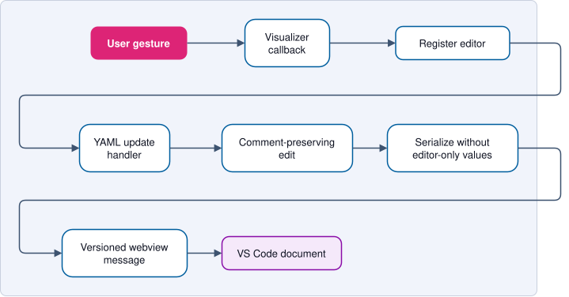

# Bit Field Developer Reference

This contributor reference lists the data shapes, callbacks, and functions used
by bit-field editing. Users looking only for commands should use the
[keyboard shortcuts](keyboard-shortcuts.md).

For the mental model see [Spatial Editing](../concepts/spatial-editing.md); for
how the pieces fit together see
[Bit Field Handling](../architecture/bit-field-handling.md).

## Data shapes

Runtime position properties on a field (all camelCase; none are persisted):

```text
bitRange : [hi, lo]        // canonical [MSB, LSB] tuple
offset   : lo              // LSB index
width    : hi - lo + 1     // field width in bits
```

Persisted field keys: `name`, `bits`, `access`, `resetValue`, `description`, and
optional `enumeratedValues` / `monitorChangeOf`.

### `ProSegment` (`bitfield/types.ts`)

A tagged union; the segment list tiles the register bit space MSB-first.

```typescript
type ProSegment =
  | { type: 'field'; idx: number; start: number; end: number; name: string; color: string }
  | { type: 'gap'; start: number; end: number };
```

`start` is the LSB of the span, `end` the MSB.

### Bit-ownership array

`buildBitOwnerArray(fields, registerSize)` returns an array of length
`registerSize` where `owners[bit] = fieldIndex | null`. Drives hit testing,
resize-boundary calculation, and gap detection.

## Keyboard shortcuts

The visualizer and field table shortcuts are listed in
[Keyboard shortcuts](keyboard-shortcuts.md#bit-field-visualizer-pro-layout).
Table navigation does not take `Ctrl` or `Cmd` chords.

## Pointer gestures

| Gesture | Trigger | Result | Commit callback |
|---------|---------|--------|-----------------|
| Resize | `Shift` + drag an edge of a field | New field range, clamped to neighbours | `onUpdateFieldRange` |
| Create | `Shift` + drag inside a gap | New field over the dragged span | `onCreateField` |
| Relocate | `Ctrl`/`Cmd` + drag a field | Field moved; others part to receive it (live preview) | `onBatchUpdateFields` |
| Toggle reset bit | Click a bit cell | Flip that bit of the owning field's `resetValue`. Ignored for a `$version` field outside Debug Mode | `onUpdateFieldReset` |
| Insert (visualizer) | Right-click a field, choose Insert Before / Insert After | New 1-bit field on the adjacent lower / higher bit; errors if occupied | `onInsertField` |
| Insert (table) | Hover a gap and click the (+) bar, or right-click a row and choose Insert Above / Insert Below | Same insertion; the (+) bar is shown only where a free bit exists | `useFieldEditor.insertFieldAt` / `insertFieldAtGap` |

Relocate commits atomically through `onBatchUpdateFields`; sequential per-field
updates would pass through overlapping intermediate states.

## Callback contracts (`RegisterEditor` <- `BitFieldVisualizer`)

| Callback | Signature | Meaning |
|----------|-----------|---------|
| `onUpdateFieldRange` | `(idx: number, [hi, lo]: [number, number])` | One field's range changed |
| `onBatchUpdateFields` | `(updates: { idx: number; range: [hi, lo] }[])` | Many ranges changed atomically |
| `onCreateField` | `({ bitRange: [hi, lo]; name: string })` | New field from a gap drag |
| `onUpdateFieldReset` | `(idx: number, value: number \| null)` | A reset bit toggled |
| `onInsertField` | `(idx: number, after: boolean)` | Insert a 1-bit field before (`false`) or after (`true`) the field at `idx` |
| `onDragPreview` | `(updates \| null)` | Transient Ctrl-drag preview (no YAML write) |

## Function reference

### Parse / format (`utils/BitFieldUtils.ts`)

| Function | Signature | Notes |
|----------|-----------|-------|
| `parseBitsRange` | `(bits: string) => [hi, lo] \| null` | Strict bracketed parse |
| `parseBitsLike` | `(text: string) => { offset, width } \| null` | Tolerant (accepts `7:0`) |
| `formatBitsRange` | `(hi: number, lo: number) => string` | Builds `'[hi:lo]'` |
| `fieldToBitsString` | `(field) => string` | Prefers `offset`/`width`, falls back to `bits` |

### Validation (`shared/utils/fieldValidation.ts`)

| Function | Signature |
|----------|-----------|
| `validateBitsString` | `(bits: string) => string \| null` (error message or null) |
| `parseBitsInput` | `(text: string) => { offset, width, ... }` |
| `parseBitsWidth` | `(bits: string) => number \| null` |
| `parseReset` | `(text: string) => number \| null` |
| `validateResetForField` | reset-value bounds check against field width |
| `resolveResetInput` | Decides what Reset cell text means: unchanged, clear, commit a number or `$version` token, or an error |
| `formatResetDisplay` | The Reset cell text: the `$version` token, else `0x..` hex |

### Layout (`algorithms/LayoutEngine.ts`)

| Function | Signature | Gaps |
|----------|-----------|------|
| `recomputeBitfieldLayout` | `(fields, regWidth) => LayoutField[]` | Removed (compact pack from bit 0) |
| `reorderBitfieldLayout` | `(fields, movedIdx, direction: 'lsb' \| 'msb', regWidth) => LayoutField[]` | Preserved; skips gap segments to swap the moved field with the next field |

### Segments and ownership (`bitfield/utils.ts`)

| Function | Signature |
|----------|-----------|
| `getFieldRange` | `(field) => { lo, hi } \| null` |
| `groupFields` | `(fields) => { idx, start, end, name, color }[]` |
| `buildProLayoutSegments` | `(fields, registerSize) => ProSegment[]` |
| `repackSegments` | `(segments: ProSegment[]) => ProSegment[]` (gap-preserving) |
| `toFieldRangeUpdates` | `(segments) => { idx, range: [hi, lo] }[]` |
| `buildBitOwnerArray` | `(fields, registerSize) => (number \| null)[]` |
| `findResizeBoundary` | resize clamp bounds from neighbours |
| `findGapBoundaries` | extent of the empty run under the cursor |

### Reorder / resize helpers

| Function | File | Signature |
|----------|------|-----------|
| `computeCtrlDragPreview` | `bitfield/reorderAlgorithm.ts` | Ctrl-drag preview segments |
| `getKeyboardReorderUpdates` | `bitfield/keyboardOperations.ts` | Gap-preserving reorder range updates |
| `getKeyboardResizeRange` | `bitfield/keyboardOperations.ts` | One-bit edge grow/shrink, bounded |

### Reset / register value (`bitfield/utils.ts`)

| Function | Signature | Notes |
|----------|-----------|-------|
| `bitAt` | `(value, bitIndex) => 0 \| 1` | Read one bit |
| `setBit` | `(value, bitIndex, desired: 0 \| 1) => number` | Write one bit |
| `extractBits` | `(value, lo, width) => number` | Slice a sub-value |
| `maxForBits` | `(bitCount) => number` | Max value for a width |
| `applyRegisterValueToFields` | decompose a register value onto each field |
| `findUnstorableBitRanges` | `(fields, value) => [hi, lo][]` — uncovered runs that carry a set bit |
| `formatBitRanges` | `([hi, lo][]) => string` — MSB-first `31:8, 3` |
| `registerResetToBitVector` | `(resetValue, registerSize) => BitVector` — fieldless register value |
| `describeConstantFieldMismatches` | `(fields, current, next) => string \| null` — why `next` changes the bits of a `$version` field |
| `parseRegisterValueDraft` | `bitfield/registerValueToken.ts`: `parseRegisterBitVector` plus the `$version` token and its typed prefixes |
| `decideRegisterToken` | `bitfield/registerValueToken.ts`: whether a typed `$version` may be written to the register |

Value math uses `Math.pow(2, n)` arithmetic (safe to 53 bits), avoiding 32-bit
bitwise truncation. Masks at width >= 53 fall back to `Number.MAX_SAFE_INTEGER`.

#### Where a register value is stored

The register Value bar has **no storage of its own**. Which key it writes
depends on whether the register has bit fields, matching what the generators
read back (`registerProcessor.ts`, `verificationManifest.ts`):

| Register | Storage | Behavior |
|----------|---------|----------|
| Has bit fields | each field's `resetValue` | The value is composed from, and decomposed onto, the fields |
| No bit fields | the register's own `resetValue` | Nothing to compose from, so the register key is the value |

Because every bit lives in the field that owns it, a value with a set bit
outside all field ranges cannot be stored. Such a commit is **rejected with
`Bits <ranges> are not covered by a bit field`** rather than written in part —
a partial write would silently drop the uncovered bits. Uncovered bits that
stay zero are not reported, so a value that fits the defined fields commits
normally.

Debug Mode keeps both forms local to the component: per-field overrides and the
fieldless register override never reach `onUpdate`, so exploration cannot land
in the `.mm.yml` (issue #39).

#### Version references (`$version`)

A `resetValue` can hold a `$version` token instead of a number (see
[Versioning Register Sets](../how-to/versioning-register-sets.md)). The domain
model keeps `resetValue: number` (0 for a token) and adds `versionRef`;
`serialize.ts` writes the token back into `resetValue`. The editor resolves it
with the version of the owning `.ip.yml` (`useVersionContext`), and reads 0 while
there is no owner.

| Surface | Behavior for a token |
|---------|----------------------|
| Reset cell | Shows the token and, under it, `= 0x<value>` (or `version unresolved`, `several IP cores import this map`). A valid token commits on the keystroke that completes it |
| Visualizer and Value bar | Show the resolved value. A token field is a constant |
| Bit click on a token field | Ignored outside Debug Mode |
| Value bar, register with fields | A value that changes the bits of a token field is **rejected with `Bits <range> hold <token> (0x..)`**; token fields are never written when the value is decomposed |
| Value bar, register without fields | Any valid reference (`$version`, `$version.major`, ..., `$version.crc8`, `$version.crc16`) is accepted and written to the register's `resetValue` in one update. A prefix of a reference such as `$ver` or `$version.cr` is not reported as an invalid number while typed. A number typed later replaces the token |
| Value bar, register with fields, a reference | Nothing is written. `$version` shows `Use $version.* on the bit fields`; another reference shows `Enter <reference> in a bit field's Reset cell`. A prefix being typed shows no error |
| Value bar commit, register with fields and its own reference | A reference left on the register next to bit fields is invalid. A successful value commit removes the register's `resetValue` key in the same update as the field writes |
| Inserting a bit field, register with its own reference | Every insert gesture (keyboard, hover bar, context menu, visualizer Shift+drag) writes the new fields and removes the register's `resetValue` key in one update (`['__op', 'register-edit']`) |
| Debug Mode | Token commits are refused with `Version references cannot be set in Debug Mode`. Numeric overrides stay local |

The Reset cell reports `Invalid number` for non-empty text that is not a number,
such as `A` or `FF` (hex needs `0x`), and does not commit it. Text that starts
with `$` but is not a valid reference shows `Unknown version reference` (or the
references of the resolved scheme) and is not committed either. A number typed
over a token commits the number and removes the token.

### Insertion (`services/SpatialInsertionService.ts`)

All methods are static and side-effect free, returning `InsertionResult<T>`:

```typescript
interface InsertionResult<T> {
  items: T[];        // updated array (unchanged on error)
  newIndex: number;  // index of the new item (-1 on error)
  error?: string;    // human-readable reason (only on failure)
}
```

| Method | Purpose |
|--------|---------|
| `insertField(dir, fields, selectedIndex, registerSize)` | Insert a 1-bit field after/before the selection |
| `insertFieldAfter` / `insertFieldBefore` | Directional variants |
| `insertRegister` / `insertRegisterAfter` / `insertRegisterBefore` | Insert a default 4-byte register |
| `insertBlock` / `insertBlockAfter` / `insertBlockBefore` | Insert a block with one register |

| Repacker | File | Functions |
|----------|------|-----------|
| Field | `algorithms/BitFieldRepacker.ts` | `repackFieldsForward`, `repackFieldsBackward` |
| Register | `algorithms/RegisterRepacker.ts` | `repackRegistersForward`, `repackRegistersBackward` |
| Block | `algorithms/AddressBlockRepacker.ts` | `repackBlocksForward`, `repackBlocksBackward` |

### Field operations (`services/FieldOperationService.ts`)

`applyFieldOperation` dispatches the `__op` ops used by the table:

| Op | Effect |
|----|--------|
| `field-move` | Swap `fields[index]` and `fields[index+delta]` (positions recomputed afterwards by `reorderBitfieldLayout`) |
| add / delete | Add a field at the first free bit / remove by index |

`RegisterEditOperation.ts` adds the `register-edit` op: several writes inside one
register, plus keys to remove, applied to the document text as one update. It is
routed like the field ops, for register and array selections and for a block
selection with `__regIndex` (master-detail). Inserting bit fields into a register
that still carries a register-level `$version`, and the Value bar commit on such
a register, use it so the reference is removed in the same update.

## Table draft layers

`FieldsTable` resolves a row's displayed bit range in priority order:

1. `dragPreviewRanges[index]` -- live Ctrl-drag preview (highest)
2. `bitsDrafts[rowId]` -- the user's uncommitted text edit
3. `fieldToBitsString(field)` -- the committed data-model value

Draft maps (`nameDrafts`, `bitsDrafts`, `resetDrafts` and their error maps) are
**keyed by `rowId`**, not by array index (`useFieldDrafts.ts`). On a reorder or
other structural change `useFieldEditor` calls `clearAllDrafts()`.

## Inline bits editing with cascade

When the user edits a bit range in the table:

1. Parse the new bits string (`parseBitsInput`).
2. Validate format and total register usage (`validateBitsString`).
3. Update the edited field's `offset` / `width` / `bitRange`.
4. Cascade fields below upward to stay non-overlapping (widths preserved).
5. Commit the full updated field array.

## Layout views

| View | File | Orientation | Used by `RegisterEditor` |
|------|------|-------------|--------------------------|
| `pro` | `bitfield/ProLayoutView.tsx` | Horizontal, MSB left, per-bit value cells | Yes (stacked register layout) |
| `vertical` | `bitfield/VerticalLayoutView.tsx` | Stacked rows | Yes (side-by-side register layout) |
| `default` | `bitfield/DefaultLayoutView.tsx` | Legacy grid | No (fallback branch only) |

## Commit path



## Test files

| Test file | Covers |
|-----------|--------|
| `algorithms/LayoutEngine.test.ts` | Compact + gap-preserving + gap-skipping layout |
| `algorithms/BitFieldRepacker.test.ts` | Forward/backward field repacking, edge clamping |
| `algorithms/RegisterRepacker.test.ts` | Register repacking |
| `algorithms/AddressBlockRepacker.test.ts` | Block repacking |
| `services/SpatialInsertionService.test.ts` | Field/register/block insertion pipeline |
| `services/FieldOperationService.test.ts` | `field-move` array mutation |
| `hooks/useFieldEditor.test.ts` | Draft management, selection, insertion, reorder |
| `hooks/useTableNavigation.test.tsx` | Navigation, Alt+arrow move, focus-follows-field |
