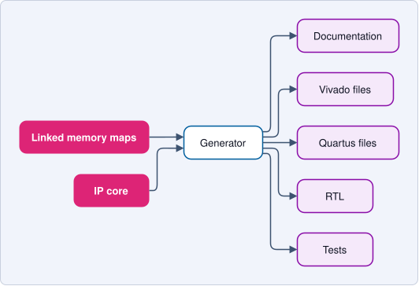
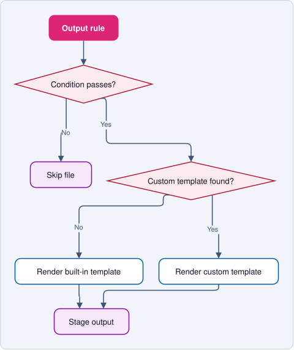

# Generator Reference

IPCraft can generate HDL, tests, documentation, and files for Vivado or Quartus.
The selected scaffold pack controls the exact file list and directory layout.



The commands that run the generator, and the staging review that shows every
file before it is written, are described in
[Generating a project](../how-to/generating-a-project.md).

## Common output layout

A complete built-in pack may produce:

```text
generated-core/
├── rtl/
│   ├── <name>_pkg.vhd
│   ├── <name>.vhd
│   ├── <name>_core.vhd
│   ├── <name>_<bus>.vhd
│   └── <name>_regs.vhd
├── tb/
│   ├── <name>_test.py
│   ├── test_<name>_sim.py
│   ├── register_model.py
│   ├── verification_manifest.json
│   └── Makefile
├── docs/
│   └── <name>_datasheet.md
├── xilinx/
│   ├── component.xml
│   └── ...
└── altera/
    ├── <name>_hw.tcl
    └── ...
```

SystemVerilog output uses `.sv` files and normally includes a package, top
module, core module, bus wrapper, and register module.

Smaller packs intentionally produce fewer files. See
[scaffold packs](../how-to/customizing-generated-files-with-scaffold-packs.md).

## Cocotb verification source of truth

For generated cocotb tests, `tb/verification_manifest.json` replaces
`memmap.yml` as the machine-readable test input. IPCraft derives the manifest
once from the normalized memory-map model and records the origin of every kind
of fact:

- register layout, reset values, access types, and array bounds come from the
  specification;
- readable and writable masks, write effects, reserved/unmapped read behavior,
  and hardware/software arbitration come from generator policy;
- bus type, data width, and byte-enable support come from the resolved bus
  binding.

`tb/register_model.py` is the transport-independent scoreboard. The generated
AXI4-Lite and Avalon-MM adapters drive that same model. The
`memmap.yml.j2` template remains available to scaffold packs as a
driver/documentation projection, but generated cocotb tests neither load nor
interpret it. It is therefore not a second verification oracle.

## Generation options

| Option | Default | Meaning |
|---|---|---|
| `targets` | `[]` | Vendor outputs such as `vivado` or `quartus` |
| `hdlLanguage` | `vhdl` | `vhdl` or `systemverilog` |
| `includeVhdl` | `true` | Include RTL files, in VHDL or SystemVerilog despite the name |
| `includeRegs` | `true` | Include generated register logic |
| `includeTestbench` | `true` | Include test files |
| `includeDocs` | `true` | Include generated Markdown documentation |
| `includeVivadoProject` | `false` | Include Vivado project and build scripts |
| `targetPart` | Setting value | Vivado FPGA part |
| `includeQuartusProject` | `false` | Include Quartus project files |
| `quartusDevice` | Setting value | Quartus device part |
| `indentStyle`, `indentSize` | Pack or setting value | Indentation of generated HDL, Tcl, XDC, and SDC files |
| `framework`, `engine` | Setting value | Testbench framework (`cocotb`, `vunit`) and simulator |

The IP Core toolbar writes the common choices to the current file or workspace
settings. Commands may ask for a missing part or device.

## Vendor targets

| Target | Packaging output |
|---|---|
| None | HDL, tests, and documentation only |
| `vivado` | `component.xml` and Vivado XGUI metadata |
| `quartus` | Platform Designer `_hw.tcl` component |
| Both | Both vendor packages |

Project creation is a separate choice. For example, Vivado packaging can be
generated without creating an out-of-context synthesis project.

## Bus selection

The generator uses the memory-mapped interface linked through `memoryMapRef`.
Supported built-in register wrappers include AXI4-Lite and Avalon
Memory-Mapped.

Use a full interface identity when possible, such as
`ipcraft:busif:axi4_lite:1.0`. IPCraft normalizes supported short names before
choosing templates.

## Template data

Templates use Nunjucks and have a `.j2` suffix. IPCraft searches the selected
scaffold pack first, then the built-in template library.



Templates do not read the YAML directly. IPCraft first validates the IP core and
its memory maps and converts them into one versioned object, so every template
sees the same calculated values: resolved widths and parameters, the primary
clock and reset with their polarity, the bus type and its expanded signals,
registers sorted by address with their software and hardware access behavior,
and the address width. Editor-only state such as `rowId`, selected cells, or
unfinished drafts is never part of it. Templates should use these calculated
values instead of interpreting raw access strings or bus aliases themselves.

Common template values:

| Value | Meaning |
|---|---|
| `name`, `display_name` | Core names suitable for files and headings |
| `is_systemverilog` | Whether SystemVerilog is selected |
| `bus_type` | Short bus name used by templates |
| `has_memory_mapped_slave` | Whether register-bus output is needed |
| `has_endian_swap` | Whether top-level endian reflow logic is needed |
| `registers` | Registers sorted by address |
| `bus_ports`, `user_ports` | Physical interface and standalone ports |
| `interrupt_ports` | Interrupt signals with resolved bus-interface and clock associations |
| `endian_swap_ports`, `endian_swap_widths` | Ports and fixed widths used by endian reflow logic |
| `generics` | Core parameters |
| `xgui_pages` | Parameter `uiPage`/`uiGroup` layout as a page-group-parameter tree, for the Vivado xGUI |
| `display_items` | The same layout flattened into Platform Designer `add_display_item` records |
| `clock_port`, `reset_port` | Primary clock and reset names |

A scaffold pack can declare the template-data version it needs with
`apiVersion` in `scaffold.yml`, for example `^1.0`. IPCraft checks that range
before rendering and rejects a pack that needs an incompatible version, instead
of rendering files with missing values. A pack without `apiVersion` is
accepted. The data contract does not guarantee that every generated file is
valid for every tool: compile the output and run the relevant vendor tests
before publishing a pack.

The versioned template-data schema is
`src/generator/contract/template_context.schema.json`. Template variables use
snake case by design; TypeScript and IPCraft schema properties use camel case.
The current contract version is 1.5.0. Version 1.5.0 adds per-register
`write_fields`, `needs_write_branch` and `read_source`, and register `access`
is derived from field accesses when a register has fields. Version 1.3.0 adds
`display_items`, display labels and Tcl-safe renderings for parameter metadata
and defaults.
Platform Designer group entries use stable internal IDs with their authored
`uiPage`/`uiGroup` text in `display_name`; templates should not treat the ID as
the visible label. Packs pinned to `~1.2` or an earlier minor must update their
range after validating the additive parameter layout context; built-in packs
use the compatible `^1.0` range.

## Testbench selection

| Framework | Supported simulator choices | Main output |
|---|---|---|
| Cocotb | GHDL, Icarus Verilog, Verilator, Questa | Python tests and simulator runner |
| VUnit | GHDL | `run.py` and VHDL testbench |

The framework controls how tests are written. The simulator choice controls how
the generated HDL is compiled and run.

See [Running a Cocotb simulation](../how-to/run-cocotb-simulation.md).

## Vendor build output

Vivado builds write reports under `xilinx/build/`; Quartus builds write output
under `altera/build/`. IPCraft parses timing and resource-use reports for the
Build view.

For commands, configuration, and report states, see
[Building a project](../how-to/building-a-project.md).

## Command line

The `ipcraft` command runs the same generator outside VS Code. See
[Command line](command-line.md).

## Contributor implementation

Implementation details belong in [generator architecture](../architecture/generator-backbone.md).
Source templates are under `src/generator/templates/`; copied files under
`dist/templates/` must not be edited.
